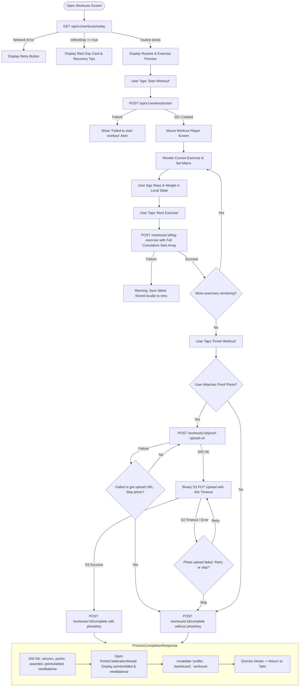
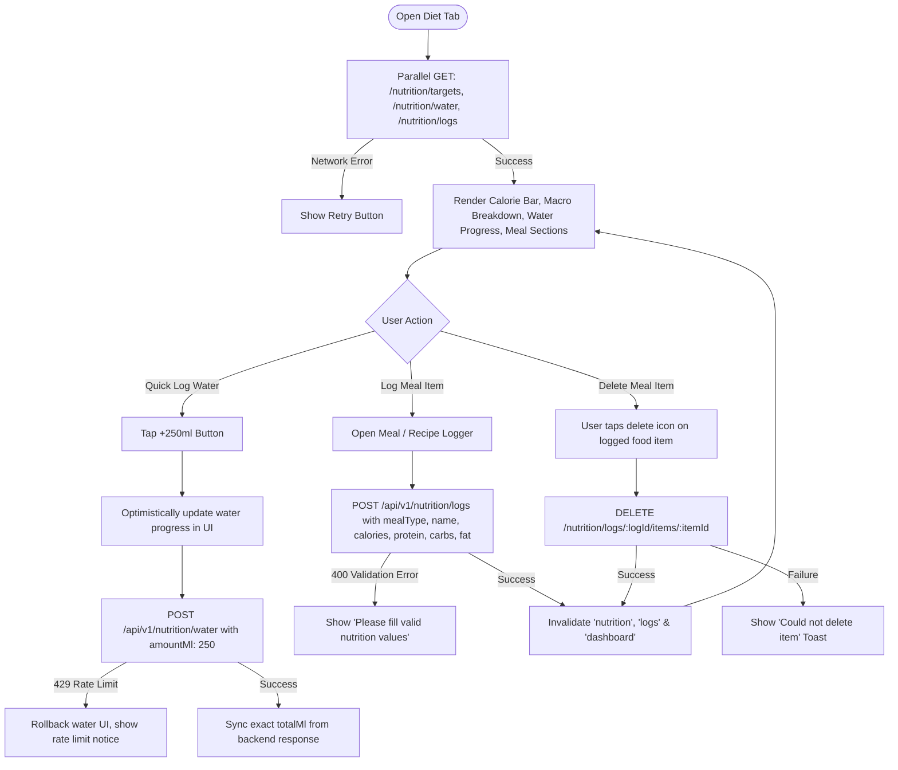
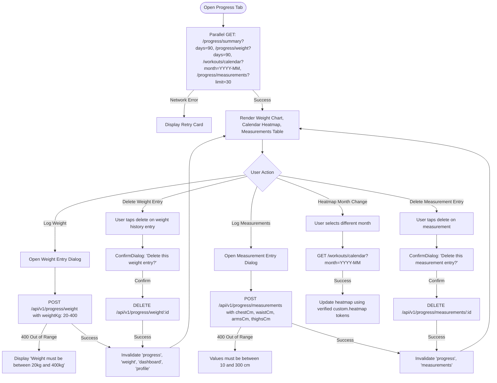
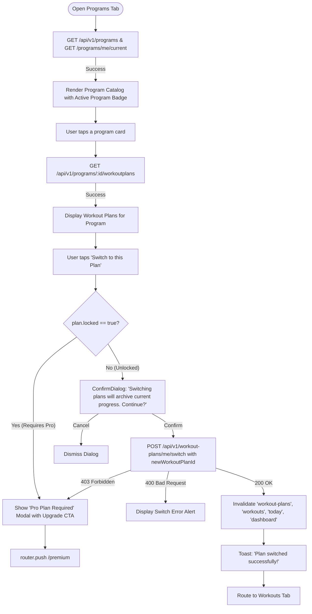
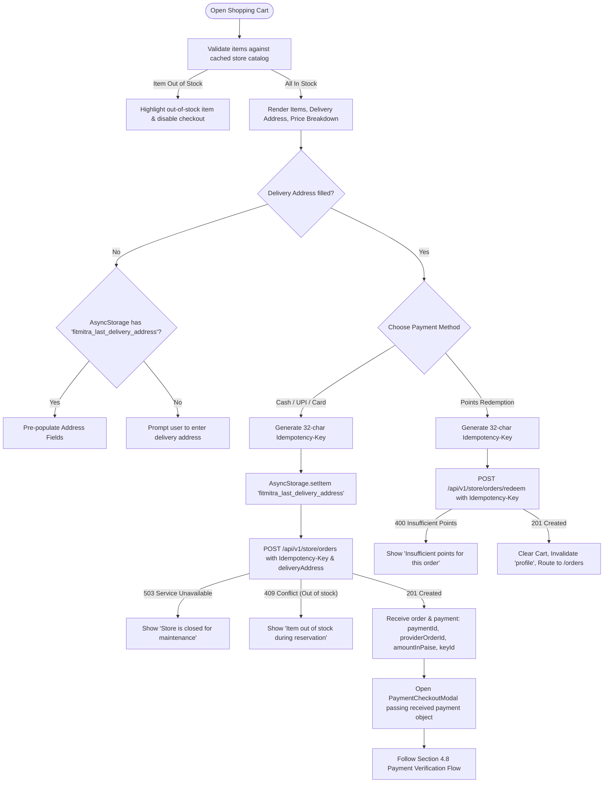
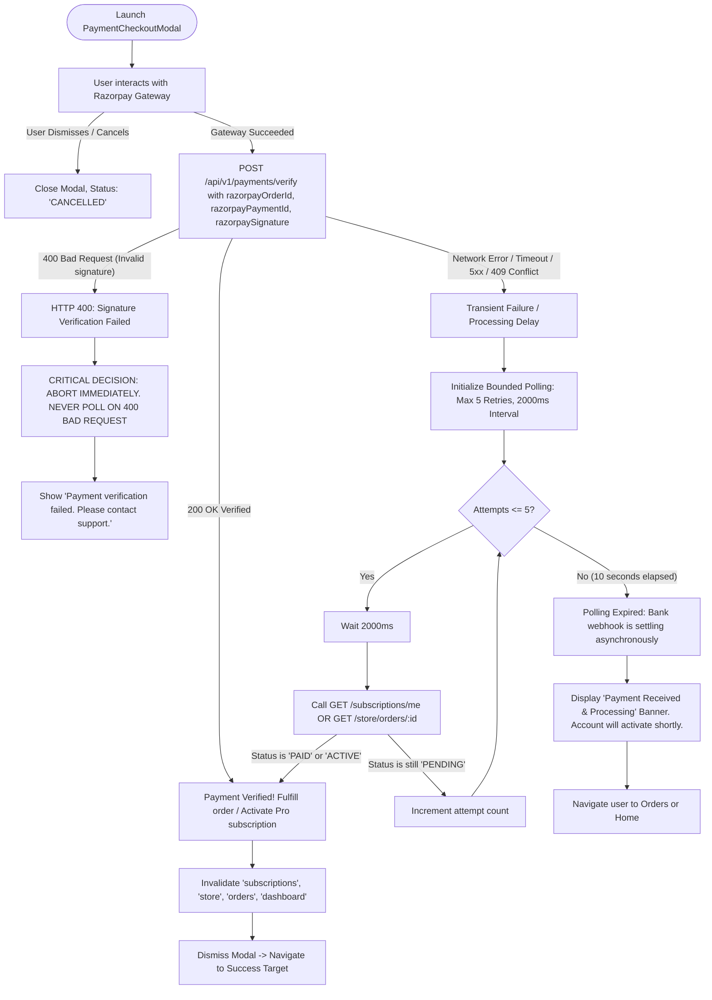
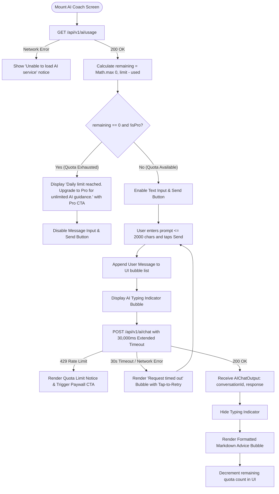
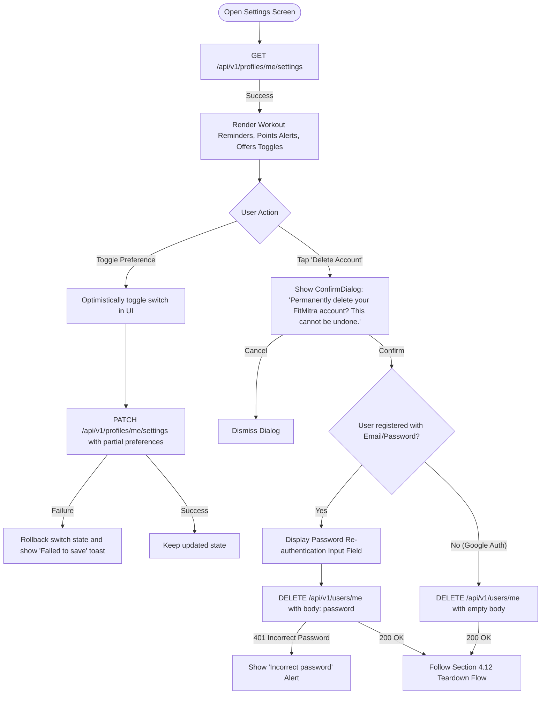

Viewed payment.validators.ts:1-68
Viewed payment.controller.ts:25-75
Viewed payment.service.ts:110-150
Viewed payment.service.ts:151-210
Searched for "cancel"
Viewed auth.controller.ts:130-165
Searched for "export const logout"
Viewed auth.service.ts:220-250
Viewed dashboard.service.ts:1-60
Viewed progress.routes.ts:1-48
Viewed progress.validators.ts:90-135
Viewed useAppConfig.js:1-33
Viewed appConfigService.js:1-36
Searched for "getAppConfigController"
Viewed app-meta.controller.ts:1-12
Viewed notification.model.ts:1-67
Viewed notification.controller.ts:11-50
Viewed notification.service.ts:1-60
Viewed notification.service.ts:61-120
Viewed notification.service.ts:121-170
Viewed index.jsx:1-60
Viewed index.jsx:200-308
Viewed MaterialCard.jsx:1-65
Viewed AppCard.jsx:1-21

Below is the complete, evidence-based **FitMitra Mobile App: Master Architectural Replan**, thoroughly verified against the active Express/TypeScript backend (`Fitmitra-private/server/`) and Expo mobile codebase (`Fitmitra/mobile/`).

No files have been modified.

---

# FitMitra Mobile App: Master Architectural Replan

---

## 01. Verified Source Audit

Every route, controller function, line number range, validation schema, and response shape below has been verified against the active server source code.

### 1.1 Complete Verified Backend Endpoint Specifications

| Module | HTTP Method & Route | Route Registration File & Line | Controller File, Handler & Verified Line Range | Validation Schema & File | Request Body / Query Params Shape | Expected Success Response Shape (`data`) | Error Status Codes & Handled Exceptions |
| :--- | :--- | :--- | :--- | :--- | :--- | :--- | :--- |
| **Auth** | `POST /api/v1/auth/register` | [auth.routes.ts:16](file:///c:/Users/Dell/OneDrive/Documents/Fitmitra/Fitmitra-private/server/src/modules/auth/auth.routes.ts#L16) | [auth.controller.ts:36-48](file:///c:/Users/Dell/OneDrive/Documents/Fitmitra/Fitmitra-private/server/src/modules/auth/auth.controller.ts#L36-L48)<br>`registerController` | `registerSchema`<br>[auth.validators.ts:15](file:///c:/Users/Dell/OneDrive/Documents/Fitmitra/Fitmitra-private/server/src/modules/auth/auth.validators.ts#L15) | `{ name: string (1-100), email: email, password: string (6-100) }` | `{ user: IUser, profile: IProfile, tokens: { idToken, refreshToken, expiresIn } }` | 400 (Validation / Email exists) |
| **Auth** | `POST /api/v1/auth/login` | [auth.routes.ts:17](file:///c:/Users/Dell/OneDrive/Documents/Fitmitra/Fitmitra-private/server/src/modules/auth/auth.routes.ts#L17) | [auth.controller.ts:50-62](file:///c:/Users/Dell/OneDrive/Documents/Fitmitra/Fitmitra-private/server/src/modules/auth/auth.controller.ts#L50-L62)<br>`loginController` | `loginSchema`<br>[auth.validators.ts:21](file:///c:/Users/Dell/OneDrive/Documents/Fitmitra/Fitmitra-private/server/src/modules/auth/auth.validators.ts#L21) | `{ email: email, password: string }` | `{ user: IUser, profile: IProfile, tokens: { idToken, refreshToken, expiresIn } }` | 401 (Invalid credentials) |
| **Auth** | `POST /api/v1/auth/refresh` | [auth.routes.ts:18](file:///c:/Users/Dell/OneDrive/Documents/Fitmitra/Fitmitra-private/server/src/modules/auth/auth.routes.ts#L18) | [auth.controller.ts:64-76](file:///c:/Users/Dell/OneDrive/Documents/Fitmitra/Fitmitra-private/server/src/modules/auth/auth.controller.ts#L64-L76)<br>`refreshController` | `refreshSchema`<br>[auth.validators.ts:26](file:///c:/Users/Dell/OneDrive/Documents/Fitmitra/Fitmitra-private/server/src/modules/auth/auth.validators.ts#L26) | `{ refreshToken: string }` | `{ tokens: { idToken, refreshToken, expiresIn } }` | 401 (Invalid / expired token) |
| **Auth** | `POST /api/v1/auth/forgot-password` | [auth.routes.ts:19](file:///c:/Users/Dell/OneDrive/Documents/Fitmitra/Fitmitra-private/server/src/modules/auth/auth.routes.ts#L19) | [auth.controller.ts:78-90](file:///c:/Users/Dell/OneDrive/Documents/Fitmitra/Fitmitra-private/server/src/modules/auth/auth.controller.ts#L78-L90)<br>`forgotPasswordController` | `forgotPasswordSchema`<br>[auth.validators.ts:30](file:///c:/Users/Dell/OneDrive/Documents/Fitmitra/Fitmitra-private/server/src/modules/auth/auth.validators.ts#L30) | `{ email: email }` | `{ message: string }` | 400 (Invalid email) |
| **Auth** | `POST /api/v1/auth/verify-reset-otp` | [auth.routes.ts:20](file:///c:/Users/Dell/OneDrive/Documents/Fitmitra/Fitmitra-private/server/src/modules/auth/auth.routes.ts#L20) | [auth.controller.ts:92-104](file:///c:/Users/Dell/OneDrive/Documents/Fitmitra/Fitmitra-private/server/src/modules/auth/auth.controller.ts#L92-L104)<br>`verifyResetOtpController` | `verifyResetOtpSchema`<br>[auth.validators.ts:34](file:///c:/Users/Dell/OneDrive/Documents/Fitmitra/Fitmitra-private/server/src/modules/auth/auth.validators.ts#L34) | `{ email: email, otp: string (/^[0-9]{6}$/) }` | `{ resetToken: string, message: string }` | 400 (Invalid / expired OTP) |
| **Auth** | `POST /api/v1/auth/reset-password` | [auth.routes.ts:21](file:///c:/Users/Dell/OneDrive/Documents/Fitmitra/Fitmitra-private/server/src/modules/auth/auth.routes.ts#L21) | [auth.controller.ts:106-118](file:///c:/Users/Dell/OneDrive/Documents/Fitmitra/Fitmitra-private/server/src/modules/auth/auth.controller.ts#L106-L118)<br>`resetPasswordController` | `resetPasswordSchema`<br>[auth.validators.ts:39](file:///c:/Users/Dell/OneDrive/Documents/Fitmitra/Fitmitra-private/server/src/modules/auth/auth.validators.ts#L39) | `{ resetToken: string, newPassword: string (6-100) }` | `{ message: string }` | 400 (Invalid / expired token) |
| **Auth** | `POST /api/v1/auth/google` | [auth.routes.ts:22](file:///c:/Users/Dell/OneDrive/Documents/Fitmitra/Fitmitra-private/server/src/modules/auth/auth.routes.ts#L22) | [auth.controller.ts:120-132](file:///c:/Users/Dell/OneDrive/Documents/Fitmitra/Fitmitra-private/server/src/modules/auth/auth.controller.ts#L120-L132)<br>`googleLoginController` | `googleLoginSchema`<br>[auth.validators.ts:44](file:///c:/Users/Dell/OneDrive/Documents/Fitmitra/Fitmitra-private/server/src/modules/auth/auth.validators.ts#L44) | `{ idToken: string }` | `{ user: IUser, profile: IProfile, tokens: { idToken, refreshToken, expiresIn } }` | 401 (Invalid Google token) |
| **Auth** | `POST /api/v1/auth/logout` | [auth.routes.ts:23](file:///c:/Users/Dell/OneDrive/Documents/Fitmitra/Fitmitra-private/server/src/modules/auth/auth.routes.ts#L23) | [auth.controller.ts:134-148](file:///c:/Users/Dell/OneDrive/Documents/Fitmitra/Fitmitra-private/server/src/modules/auth/auth.controller.ts#L134-L148)<br>`logoutController` | `logoutSchema`<br>[auth.validators.ts:48](file:///c:/Users/Dell/OneDrive/Documents/Fitmitra/Fitmitra-private/server/src/modules/auth/auth.validators.ts#L48) | `{ deviceToken?: string }` | `{ message: string }` | 401 (Unauthorized) |
| **Auth** | `POST /api/v1/auth/send-verification-email` | [auth.routes.ts:27](file:///c:/Users/Dell/OneDrive/Documents/Fitmitra/Fitmitra-private/server/src/modules/auth/auth.routes.ts#L27) | [auth.controller.ts:167-181](file:///c:/Users/Dell/OneDrive/Documents/Fitmitra/Fitmitra-private/server/src/modules/auth/auth.controller.ts#L167-L181)<br>`sendVerificationEmailController` | None (Authenticated) | None | `{ message: string }` | 401 (Unauthorized) |
| **Auth** | `POST /api/v1/auth/verify-email` | [auth.routes.ts:28](file:///c:/Users/Dell/OneDrive/Documents/Fitmitra/Fitmitra-private/server/src/modules/auth/auth.routes.ts#L28) | [auth.controller.ts:183-197](file:///c:/Users/Dell/OneDrive/Documents/Fitmitra/Fitmitra-private/server/src/modules/auth/auth.controller.ts#L183-L197)<br>`verifyEmailController` | `verifyEmailSchema`<br>[auth.validators.ts:58](file:///c:/Users/Dell/OneDrive/Documents/Fitmitra/Fitmitra-private/server/src/modules/auth/auth.validators.ts#L58) | `{ otp: string (/^[0-9]{6}$/) }` | `{ message: string, user: IUser }` | 400 (Invalid OTP), 401 |
| **Users** | `GET /api/v1/users/me` | [user.routes.ts:11](file:///c:/Users/Dell/OneDrive/Documents/Fitmitra/Fitmitra-private/server/src/modules/users/user.routes.ts#L11) | [user.controller.ts:9-24](file:///c:/Users/Dell/OneDrive/Documents/Fitmitra/Fitmitra-private/server/src/modules/users/user.controller.ts#L9-L24)<br>`getMeController` | None (Authenticated) | None | `{ user: { id, email, name, emailVerified, isOnboarded, isPremium, role }, profile: IProfile }` | 401, 404 |
| **Users** | `DELETE /api/v1/users/me` | [user.routes.ts:12](file:///c:/Users/Dell/OneDrive/Documents/Fitmitra/Fitmitra-private/server/src/modules/users/user.routes.ts#L12) | [user.controller.ts:26-44](file:///c:/Users/Dell/OneDrive/Documents/Fitmitra/Fitmitra-private/server/src/modules/users/user.controller.ts#L26-L44)<br>`deleteMeController` | `deleteUserSchema`<br>[user.validators.ts:4](file:///c:/Users/Dell/OneDrive/Documents/Fitmitra/Fitmitra-private/server/src/modules/users/user.validators.ts#L4) | `{ password?: string }` | `{ message: string }` | 400, 401 (Invalid password) |
| **Profiles** | `POST /api/v1/profiles/me/onboarding` | [profile.routes.ts:18](file:///c:/Users/Dell/OneDrive/Documents/Fitmitra/Fitmitra-private/server/src/modules/profiles/profile.routes.ts#L18) | [profile.controller.ts:14-29](file:///c:/Users/Dell/OneDrive/Documents/Fitmitra/Fitmitra-private/server/src/modules/profiles/profile.controller.ts#L14-L29)<br>`onboardingController` | `onboardingSchema`<br>[profile.validators.ts:28](file:///c:/Users/Dell/OneDrive/Documents/Fitmitra/Fitmitra-private/server/src/modules/profiles/profile.validators.ts#L28) | `{ gender, age, heightCm, weight, selectedGoal, selectedWorkoutPlan, experienceLevel, preferredWorkoutLocation, preferredWorkoutDays, preferredWorkoutTime, dietType, dailyDietBudget, notificationSettings? }` | `{ profile: IProfile, userWorkoutPlan: IUserWorkoutPlan }` | 400 (Validation), 403 (Pro required), 401 |
| **Profiles** | `GET /api/v1/profiles/me` | [profile.routes.ts:16](file:///c:/Users/Dell/OneDrive/Documents/Fitmitra/Fitmitra-private/server/src/modules/profiles/profile.routes.ts#L16) | [profile.controller.ts:31-46](file:///c:/Users/Dell/OneDrive/Documents/Fitmitra/Fitmitra-private/server/src/modules/profiles/profile.controller.ts#L31-L46)<br>`getProfileController` | None (Authenticated) | None | `IProfile` (points, currentStreak, longestStreak, biometrics, goals) | 401 |
| **Profiles** | `PATCH /api/v1/profiles/me` | [profile.routes.ts:17](file:///c:/Users/Dell/OneDrive/Documents/Fitmitra/Fitmitra-private/server/src/modules/profiles/profile.routes.ts#L17) | [profile.controller.ts:48-64](file:///c:/Users/Dell/OneDrive/Documents/Fitmitra/Fitmitra-private/server/src/modules/profiles/profile.controller.ts#L48-L64)<br>`updateProfileController` | `updateProfileSchema`<br>[profile.validators.ts:8](file:///c:/Users/Dell/OneDrive/Documents/Fitmitra/Fitmitra-private/server/src/modules/profiles/profile.validators.ts#L8) | Partial biometrics, habits, selectedGoal, weight | `IProfile` | 400, 401 |
| **Profiles** | `GET /api/v1/profiles/leaderboard` | [profile.routes.ts:21](file:///c:/Users/Dell/OneDrive/Documents/Fitmitra/Fitmitra-private/server/src/modules/profiles/profile.routes.ts#L21) | [profile.controller.ts:66-81](file:///c:/Users/Dell/OneDrive/Documents/Fitmitra/Fitmitra-private/server/src/modules/profiles/profile.controller.ts#L66-L81)<br>`getLeaderboardController` | None (Authenticated) | None | `{ leaderboard: Array<RankUser>, myRank: { rank, points, streak } }` | 401 |
| **Profiles** | `GET /api/v1/profiles/me/settings` | [profile.routes.ts:19](file:///c:/Users/Dell/OneDrive/Documents/Fitmitra/Fitmitra-private/server/src/modules/profiles/profile.routes.ts#L19) | [profile.controller.ts:83-95](file:///c:/Users/Dell/OneDrive/Documents/Fitmitra/Fitmitra-private/server/src/modules/profiles/profile.controller.ts#L83-L95)<br>`getNotificationSettingsController` | None (Authenticated) | None | `{ workoutReminders, pointsAlerts, offersAndNews }` | 401 |
| **Profiles** | `PATCH /api/v1/profiles/me/settings` | [profile.routes.ts:20](file:///c:/Users/Dell/OneDrive/Documents/Fitmitra/Fitmitra-private/server/src/modules/profiles/profile.routes.ts#L20) | [profile.controller.ts:97-111](file:///c:/Users/Dell/OneDrive/Documents/Fitmitra/Fitmitra-private/server/src/modules/profiles/profile.controller.ts#L97-L111)<br>`updateNotificationSettingsController` | `updateNotificationSettingsSchema`<br>[profile.validators.ts:22](file:///c:/Users/Dell/OneDrive/Documents/Fitmitra/Fitmitra-private/server/src/modules/profiles/profile.validators.ts#L22) | `{ workoutReminders?, pointsAlerts?, offersAndNews? }` | `{ workoutReminders, pointsAlerts, offersAndNews }` | 400, 401 |
| **Programs** | `GET /api/v1/programs` | [program.routes.ts:12](file:///c:/Users/Dell/OneDrive/Documents/Fitmitra/Fitmitra-private/server/src/modules/programs/program.routes.ts#L12) | [program.controller.ts:10-34](file:///c:/Users/Dell/OneDrive/Documents/Fitmitra/Fitmitra-private/server/src/modules/programs/program.controller.ts#L10-L34)<br>`getProgramsController` | `listProgramsQuerySchema`<br>[program.validators.ts:4](file:///c:/Users/Dell/OneDrive/Documents/Fitmitra/Fitmitra-private/server/src/modules/programs/program.validators.ts#L4) | Query: `{ goal?, level?, isPremium?, page?, limit? }` | `Array<IProgram>` (with `locked` boolean per item) | None |
| **Programs** | `GET /api/v1/programs/:id` | [program.routes.ts:13](file:///c:/Users/Dell/OneDrive/Documents/Fitmitra/Fitmitra-private/server/src/modules/programs/program.routes.ts#L13) | [program.controller.ts:36-80](file:///c:/Users/Dell/OneDrive/Documents/Fitmitra/Fitmitra-private/server/src/modules/programs/program.controller.ts#L36-L80)<br>`getProgramDetailController` | `programIdParamSchema`<br>[program.validators.ts:12](file:///c:/Users/Dell/OneDrive/Documents/Fitmitra/Fitmitra-private/server/src/modules/programs/program.validators.ts#L12) | Param: `:id` | `IProgram` (schedule, exercises, `locked` boolean) | 404 |
| **Programs** | `GET /api/v1/programs/me/current` | [program.routes.ts:14](file:///c:/Users/Dell/OneDrive/Documents/Fitmitra/Fitmitra-private/server/src/modules/programs/program.routes.ts#L14) | [program.controller.ts:82-121](file:///c:/Users/Dell/OneDrive/Documents/Fitmitra/Fitmitra-private/server/src/modules/programs/program.controller.ts#L82-L121)<br>`getCurrentProgramController` | None (Authenticated) | None | `{ program: { id, title, goal, level }, startDateKey, weekNumber, dayNumber }` | 401 |
| **Programs** | `GET /api/v1/programs/:id/workoutplans` | [program.routes.ts:17](file:///c:/Users/Dell/OneDrive/Documents/Fitmitra/Fitmitra-private/server/src/modules/programs/program.routes.ts#L17) | [program.controller.ts:140-160](file:///c:/Users/Dell/OneDrive/Documents/Fitmitra/Fitmitra-private/server/src/modules/programs/program.controller.ts#L140-L160)<br>`getProgramWorkoutPlansController` | None (Authenticated) | Param: `:id`, Query: `{ page?, limit? }` | `Array<IWorkoutPlan>` (with `locked` boolean per item) | 401, 404 |
| **Workout Plans** | `POST /api/v1/workout-plans/me/switch` | [workout-plan.routes.ts:19](file:///c:/Users/Dell/OneDrive/Documents/Fitmitra/Fitmitra-private/server/src/modules/workouts/workout-plan.routes.ts#L19) | [workout-plan.controller.ts:80-99](file:///c:/Users/Dell/OneDrive/Documents/Fitmitra/Fitmitra-private/server/src/modules/workouts/workout-plan.controller.ts#L80-L99)<br>`switchWorkoutPlanController` | `switchWorkoutPlanSchema`<br>[workout-plan.validators.ts:16](file:///c:/Users/Dell/OneDrive/Documents/Fitmitra/Fitmitra-private/server/src/modules/workouts/workout-plan.validators.ts#L16) | `{ newWorkoutPlanId: string }` | `{ message: string, userWorkoutPlan: IUserWorkoutPlan }` | 400, 401, 403, 404 |
| **Workouts** | `POST /api/v1/workouts/start` | [workout.routes.ts:18](file:///c:/Users/Dell/OneDrive/Documents/Fitmitra/Fitmitra-private/server/src/modules/workouts/workout.routes.ts#L18) | [workout.controller.ts:18-31](file:///c:/Users/Dell/OneDrive/Documents/Fitmitra/Fitmitra-private/server/src/modules/workouts/workout.controller.ts#L18-L31)<br>`startWorkoutController` | `startWorkoutSchema`<br>[workout.validators.ts:4](file:///c:/Users/Dell/OneDrive/Documents/Fitmitra/Fitmitra-private/server/src/modules/workouts/workout.validators.ts#L4) | `{ programId?, workoutPlanId?, dayNumber?, dayOfWeek?, title? }` | `IWorkoutSession` (status: 'STARTED') | 400, 401 |
| **Workouts** | `POST /api/v1/workouts/:id/log-exercise` | [workout.routes.ts:19](file:///c:/Users/Dell/OneDrive/Documents/Fitmitra/Fitmitra-private/server/src/modules/workouts/workout.routes.ts#L19) | [workout.controller.ts:33-46](file:///c:/Users/Dell/OneDrive/Documents/Fitmitra/Fitmitra-private/server/src/modules/workouts/workout.controller.ts#L33-L46)<br>`logExerciseController` | `logExerciseSchema`<br>[workout.validators.ts:13](file:///c:/Users/Dell/OneDrive/Documents/Fitmitra/Fitmitra-private/server/src/modules/workouts/workout.validators.ts#L13) | `{ exerciseId: string, sets: Array<{ setNumber, reps, weightKg?, rpe?, completed }> }` | `{ workoutSessionId, userId, exerciseId, sets, notes }` | 400, 401, 404 |
| **Workouts** | `POST /api/v1/workouts/:id/complete` | [workout.routes.ts:20](file:///c:/Users/Dell/OneDrive/Documents/Fitmitra/Fitmitra-private/server/src/modules/workouts/workout.routes.ts#L20) | [workout.controller.ts:48-62](file:///c:/Users/Dell/OneDrive/Documents/Fitmitra/Fitmitra-private/server/src/modules/workouts/workout.controller.ts#L48-L62)<br>`completeWorkoutController` | `completeWorkoutSchema`<br>[workout.validators.ts:28](file:///c:/Users/Dell/OneDrive/Documents/Fitmitra/Fitmitra-private/server/src/modules/workouts/workout.validators.ts#L28) | `{ durationSeconds?, caloriesEstimate?, photoKey? }` | `{ session: IWorkoutSession, points: { awarded, pointsAdded, newBalance } }` | 400, 401, 404 |
| **Workouts** | `POST /api/v1/workouts/:id/abandon` | [workout.routes.ts:21](file:///c:/Users/Dell/OneDrive/Documents/Fitmitra/Fitmitra-private/server/src/modules/workouts/workout.routes.ts#L21) | [workout.controller.ts:64-78](file:///c:/Users/Dell/OneDrive/Documents/Fitmitra/Fitmitra-private/server/src/modules/workouts/workout.controller.ts#L64-L78)<br>`abandonWorkoutController` | None (Authenticated) | None | `IWorkoutSession` (status: 'ABANDONED') | 401, 404 |
| **Workouts** | `GET /api/v1/workouts/today` | [workout.routes.ts:24](file:///c:/Users/Dell/OneDrive/Documents/Fitmitra/Fitmitra-private/server/src/modules/workouts/workout.routes.ts#L24) | [workout.controller.ts:115-127](file:///c:/Users/Dell/OneDrive/Documents/Fitmitra/Fitmitra-private/server/src/modules/workouts/workout.controller.ts#L115-L127)<br>`getTodayWorkoutController` | None (Authenticated) | None | `{ routine, activeSession, isRestDay, dayName, program, workoutPlan }` | 401 |
| **Workouts** | `GET /api/v1/workouts/calendar` | [workout.routes.ts:25](file:///c:/Users/Dell/OneDrive/Documents/Fitmitra/Fitmitra-private/server/src/modules/workouts/workout.routes.ts#L25) | [workout.controller.ts:129-142](file:///c:/Users/Dell/OneDrive/Documents/Fitmitra/Fitmitra-private/server/src/modules/workouts/workout.controller.ts#L129-L142)<br>`getWorkoutCalendarController` | `calendarQuerySchema`<br>[workout.validators.ts:34](file:///c:/Users/Dell/OneDrive/Documents/Fitmitra/Fitmitra-private/server/src/modules/workouts/workout.validators.ts#L34) | Query: `{ month: 'YYYY-MM' }` | `{ activeDates: string[] }` | 400, 401 |
| **Workouts** | `GET /api/v1/workouts/:id` | [workout.routes.ts:26](file:///c:/Users/Dell/OneDrive/Documents/Fitmitra/Fitmitra-private/server/src/modules/workouts/workout.routes.ts#L26) | [workout.controller.ts:144-157](file:///c:/Users/Dell/OneDrive/Documents/Fitmitra/Fitmitra-private/server/src/modules/workouts/workout.controller.ts#L144-L157)<br>`getWorkoutDetailController` | None (Authenticated) | Param: `:id` | `IWorkoutSession` (populated exercise logs) | 401, 404 |
| **Workouts** | `POST /api/v1/workouts/:id/proof-upload-url` | [workout.routes.ts:27](file:///c:/Users/Dell/OneDrive/Documents/Fitmitra/Fitmitra-private/server/src/modules/workouts/workout.routes.ts#L27) | [workout.controller.ts:159-174](file:///c:/Users/Dell/OneDrive/Documents/Fitmitra/Fitmitra-private/server/src/modules/workouts/workout.controller.ts#L159-L174)<br>`getProofUploadUrlController` | `proofUploadUrlSchema`<br>[workout.validators.ts:40](file:///c:/Users/Dell/OneDrive/Documents/Fitmitra/Fitmitra-private/server/src/modules/workouts/workout.validators.ts#L40) | `{ mimeType: string }` | `{ uploadUrl: string, photoKey: string, s3Url: string }` | 400, 401, 404 |
| **Nutrition** | `GET /api/v1/nutrition/recipes` | [nutrition.routes.ts:47](file:///c:/Users/Dell/OneDrive/Documents/Fitmitra/Fitmitra-private/server/src/modules/nutrition/nutrition.routes.ts#L47) | [nutrition.controller.ts:37-51](file:///c:/Users/Dell/OneDrive/Documents/Fitmitra/Fitmitra-private/server/src/modules/nutrition/nutrition.controller.ts#L37-L51)<br>`getRecipesController` | `listRecipesSchema`<br>[nutrition.validators.ts:4](file:///c:/Users/Dell/OneDrive/Documents/Fitmitra/Fitmitra-private/server/src/modules/nutrition/nutrition.validators.ts#L4) | Query: `{ mealType?, dietType?, search?, page?, limit? }` | `Array<IRecipe>` (paginated) | 401 |
| **Nutrition** | `GET /api/v1/nutrition/recipes/:id` | [nutrition.routes.ts:55](file:///c:/Users/Dell/OneDrive/Documents/Fitmitra/Fitmitra-private/server/src/modules/nutrition/nutrition.routes.ts#L55) | [nutrition.controller.ts:65-79](file:///c:/Users/Dell/OneDrive/Documents/Fitmitra/Fitmitra-private/server/src/modules/nutrition/nutrition.controller.ts#L65-L79)<br>`getRecipeDetailController` | `validateObjectIdParam` | Param: `:id` | `IRecipe` (ingredients, steps, macros) | 401, 404 |
| **Nutrition** | `GET /api/v1/nutrition/logs` | [nutrition.routes.ts:68](file:///c:/Users/Dell/OneDrive/Documents/Fitmitra/Fitmitra-private/server/src/modules/nutrition/nutrition.routes.ts#L68) | [nutrition.controller.ts:82-96](file:///c:/Users/Dell/OneDrive/Documents/Fitmitra/Fitmitra-private/server/src/modules/nutrition/nutrition.controller.ts#L82-L96)<br>`getNutritionLogsController` | `getNutritionLogsQuerySchema`<br>[nutrition.validators.ts:14](file:///c:/Users/Dell/OneDrive/Documents/Fitmitra/Fitmitra-private/server/src/modules/nutrition/nutrition.validators.ts#L14) | Query: `{ date: 'YYYY-MM-DD' }` | `{ logs: Array<INutritionLog>, dailyTotals: { calories, protein, carbs, fat } }` | 400, 401 |
| **Nutrition** | `POST /api/v1/nutrition/logs` | [nutrition.routes.ts:69](file:///c:/Users/Dell/OneDrive/Documents/Fitmitra/Fitmitra-private/server/src/modules/nutrition/nutrition.routes.ts#L69) | [nutrition.controller.ts:106-119](file:///c:/Users/Dell/OneDrive/Documents/Fitmitra/Fitmitra-private/server/src/modules/nutrition/nutrition.controller.ts#L106-L119)<br>`logMealController` | `logMealSchema`<br>[nutrition.validators.ts:24](file:///c:/Users/Dell/OneDrive/Documents/Fitmitra/Fitmitra-private/server/src/modules/nutrition/nutrition.validators.ts#L24) | `{ mealType, name, calories, protein, carbs, fat, fiber?, servingSize? }` | `INutritionLog` | 400, 401 |
| **Nutrition** | `DELETE /api/v1/nutrition/logs/:logId/items/:itemId` | [nutrition.routes.ts:71](file:///c:/Users/Dell/OneDrive/Documents/Fitmitra/Fitmitra-private/server/src/modules/nutrition/nutrition.routes.ts#L71) | [nutrition.controller.ts:121-135](file:///c:/Users/Dell/OneDrive/Documents/Fitmitra/Fitmitra-private/server/src/modules/nutrition/nutrition.controller.ts#L121-L135)<br>`deleteMealItemController` | `validateObjectIdParam` | Params: `:logId`, `:itemId` | `INutritionLog` | 401, 404 |
| **Nutrition** | `GET /api/v1/nutrition/targets` | [nutrition.routes.ts:63](file:///c:/Users/Dell/OneDrive/Documents/Fitmitra/Fitmitra-private/server/src/modules/nutrition/nutrition.routes.ts#L63) | [nutrition.controller.ts:138-150](file:///c:/Users/Dell/OneDrive/Documents/Fitmitra/Fitmitra-private/server/src/modules/nutrition/nutrition.controller.ts#L138-L150)<br>`getTargetsController` | None (Authenticated) | None | `{ calories, proteinG, carbsG, fatsG, waterMl }` | 401 |
| **Nutrition** | `GET /api/v1/nutrition/water` | [nutrition.routes.ts:64](file:///c:/Users/Dell/OneDrive/Documents/Fitmitra/Fitmitra-private/server/src/modules/nutrition/nutrition.routes.ts#L64) | [nutrition.controller.ts:153-165](file:///c:/Users/Dell/OneDrive/Documents/Fitmitra/Fitmitra-private/server/src/modules/nutrition/nutrition.controller.ts#L153-L165)<br>`getWaterController` | Query date | Query: `{ date?: 'YYYY-MM-DD' }` | `{ dateKey, totalMl, targetMl }` | 401 |
| **Nutrition** | `POST /api/v1/nutrition/water` | [nutrition.routes.ts:65](file:///c:/Users/Dell/OneDrive/Documents/Fitmitra/Fitmitra-private/server/src/modules/nutrition/nutrition.routes.ts#L65) | [nutrition.controller.ts:168-180](file:///c:/Users/Dell/OneDrive/Documents/Fitmitra/Fitmitra-private/server/src/modules/nutrition/nutrition.controller.ts#L168-L180)<br>`postWaterController` | `waterPostRateLimiter` | `{ amountMl: number }` | `{ dateKey, totalMl, targetMl }` | 400, 401, 429 |
| **Progress** | `POST /api/v1/progress/weight` | [progress.routes.ts:28](file:///c:/Users/Dell/OneDrive/Documents/Fitmitra/Fitmitra-private/server/src/modules/progress/progress.routes.ts#L28) | [progress.controller.ts:30-43](file:///c:/Users/Dell/OneDrive/Documents/Fitmitra/Fitmitra-private/server/src/modules/progress/progress.controller.ts#L30-L43)<br>`postWeightController` | `validateUpsertWeight`<br>[progress.validators.ts:51](file:///c:/Users/Dell/OneDrive/Documents/Fitmitra/Fitmitra-private/server/src/modules/progress/progress.validators.ts#L51) | `{ weightKg: number (20-400), dateKey?: string }` | `IWeightLog` | 400, 401 |
| **Progress** | `GET /api/v1/progress/weight` | [progress.routes.ts:29](file:///c:/Users/Dell/OneDrive/Documents/Fitmitra/Fitmitra-private/server/src/modules/progress/progress.routes.ts#L29) | [progress.controller.ts:45-58](file:///c:/Users/Dell/OneDrive/Documents/Fitmitra/Fitmitra-private/server/src/modules/progress/progress.controller.ts#L45-L58)<br>`getWeightController` | `validateWeightQuery`<br>[progress.validators.ts:72](file:///c:/Users/Dell/OneDrive/Documents/Fitmitra/Fitmitra-private/server/src/modules/progress/progress.validators.ts#L72) | Query: `{ days?: number }` (1-730, default 90) | `Array<IWeightLog>` | 400, 401 |
| **Progress** | `DELETE /api/v1/progress/weight/:id` | [progress.routes.ts:30](file:///c:/Users/Dell/OneDrive/Documents/Fitmitra/Fitmitra-private/server/src/modules/progress/progress.routes.ts#L30) | [progress.controller.ts:60-73](file:///c:/Users/Dell/OneDrive/Documents/Fitmitra/Fitmitra-private/server/src/modules/progress/progress.controller.ts#L60-L73)<br>`deleteWeightController` | None (Authenticated) | Param: `:id` | `{ success: true, message: string }` | 401, 404 |
| **Progress** | `POST /api/v1/progress/measurements` | [progress.routes.ts:33](file:///c:/Users/Dell/OneDrive/Documents/Fitmitra/Fitmitra-private/server/src/modules/progress/progress.routes.ts#L33) | [progress.controller.ts:78-91](file:///c:/Users/Dell/OneDrive/Documents/Fitmitra/Fitmitra-private/server/src/modules/progress/progress.controller.ts#L78-L91)<br>`postMeasurementsController` | `validateUpsertMeasurements`<br>[progress.validators.ts:94](file:///c:/Users/Dell/OneDrive/Documents/Fitmitra/Fitmitra-private/server/src/modules/progress/progress.validators.ts#L94) | `{ dateKey?: string, chestCm?, waistCm?, armsCm?, thighsCm? }` (10-300 cm) | `IMeasurement` | 400, 401 |
| **Progress** | `GET /api/v1/progress/measurements` | [progress.routes.ts:34](file:///c:/Users/Dell/OneDrive/Documents/Fitmitra/Fitmitra-private/server/src/modules/progress/progress.routes.ts#L34) | [progress.controller.ts:93-106](file:///c:/Users/Dell/OneDrive/Documents/Fitmitra/Fitmitra-private/server/src/modules/progress/progress.controller.ts#L93-L106)<br>`getMeasurementsController` | `validateMeasurementsQuery`<br>[progress.validators.ts:129](file:///c:/Users/Dell/OneDrive/Documents/Fitmitra/Fitmitra-private/server/src/modules/progress/progress.validators.ts#L129) | Query: `{ limit?: number }` (1-100, default 30) | `Array<IMeasurement>` | 400, 401 |
| **Progress** | `DELETE /api/v1/progress/measurements/:id` | [progress.routes.ts:35](file:///c:/Users/Dell/OneDrive/Documents/Fitmitra/Fitmitra-private/server/src/modules/progress/progress.routes.ts#L35) | [progress.controller.ts:108-121](file:///c:/Users/Dell/OneDrive/Documents/Fitmitra/Fitmitra-private/server/src/modules/progress/progress.controller.ts#L108-L121)<br>`deleteMeasurementController` | None (Authenticated) | Param: `:id` | `{ success: true, message: string }` | 401, 404 |
| **Progress** | `GET /api/v1/progress/summary` | [progress.routes.ts:45](file:///c:/Users/Dell/OneDrive/Documents/Fitmitra/Fitmitra-private/server/src/modules/progress/progress.routes.ts#L45) | [progress.controller.ts:189-204](file:///c:/Users/Dell/OneDrive/Documents/Fitmitra/Fitmitra-private/server/src/modules/progress/progress.controller.ts#L189-L204)<br>`getProgressSummaryController` | `validateSummaryQuery`<br>[progress.validators.ts:220](file:///c:/Users/Dell/OneDrive/Documents/Fitmitra/Fitmitra-private/server/src/modules/progress/progress.validators.ts#L220) | Query: `{ days?: number }` (1-730, default 90) | `{ weightChange, workoutsCompleted, streak, activeDays }` | 400, 401 |
| **Store** | `GET /api/v1/store/products` | [store.routes.ts:18](file:///c:/Users/Dell/OneDrive/Documents/Fitmitra/Fitmitra-private/server/src/modules/store/store.routes.ts#L18) | [store.controller.ts:16-34](file:///c:/Users/Dell/OneDrive/Documents/Fitmitra/Fitmitra-private/server/src/modules/store/store.controller.ts#L16-L34)<br>`getProductsController` | `listProductsSchema`<br>[store.validators.ts:19](file:///c:/Users/Dell/OneDrive/Documents/Fitmitra/Fitmitra-private/server/src/modules/store/store.validators.ts#L19) | Query: `{ category?, search?, page?, limit? }` | `Array<IProduct>` (paginated) | None |
| **Store** | `POST /api/v1/store/orders` | [store.routes.ts:58-59](file:///c:/Users/Dell/OneDrive/Documents/Fitmitra/Fitmitra-private/server/src/modules/store/store.routes.ts#L58-L59) | [store.controller.ts:50-71](file:///c:/Users/Dell/OneDrive/Documents/Fitmitra/Fitmitra-private/server/src/modules/store/store.controller.ts#L50-L71)<br>`createCashOrderController` | `createCashOrderSchema`<br>[store.validators.ts:40](file:///c:/Users/Dell/OneDrive/Documents/Fitmitra/Fitmitra-private/server/src/modules/store/store.validators.ts#L40) | Header: `Idempotency-Key` (16-64 chars), Body: `{ items: [{ productId, quantity }], deliveryAddress: { fullName, phone, addressLine1, addressLine2?, city, state, pincode, country } }` | `{ order: IOrder, payment: { paymentId, providerOrderId, amountInPaise, currency: 'INR', keyId } }` | 400, 401, 409 (Out of stock), 503 (Store disabled) |
| **Store** | `POST /api/v1/store/orders/redeem` | [store.routes.ts:63-64](file:///c:/Users/Dell/OneDrive/Documents/Fitmitra/Fitmitra-private/server/src/modules/store/store.routes.ts#L63-L64) | [store.controller.ts:73-94](file:///c:/Users/Dell/OneDrive/Documents/Fitmitra/Fitmitra-private/server/src/modules/store/store.controller.ts#L73-L94)<br>`createPointsOrderController` | `createPointsOrderSchema`<br>[store.validators.ts:50](file:///c:/Users/Dell/OneDrive/Documents/Fitmitra/Fitmitra-private/server/src/modules/store/store.validators.ts#L50) | Header: `Idempotency-Key`, Body: `{ items: [{ productId, quantity }], deliveryAddress }` | `{ order: IOrder, pointsDeducted: number }` | 400 (Insufficient points), 401 |
| **Store** | `GET /api/v1/store/orders` | [store.routes.ts:23](file:///c:/Users/Dell/OneDrive/Documents/Fitmitra/Fitmitra-private/server/src/modules/store/store.routes.ts#L23) | [store.controller.ts:96-115](file:///c:/Users/Dell/OneDrive/Documents/Fitmitra/Fitmitra-private/server/src/modules/store/store.controller.ts#L96-L115)<br>`getUserOrdersController` | None (Authenticated) | Query: `{ page?, limit? }` | `Array<IOrder>` (paginated) | 401 |
| **Store** | `GET /api/v1/store/orders/:id` | [store.routes.ts:24](file:///c:/Users/Dell/OneDrive/Documents/Fitmitra/Fitmitra-private/server/src/modules/store/store.routes.ts#L24) | [store.controller.ts:117-130](file:///c:/Users/Dell/OneDrive/Documents/Fitmitra/Fitmitra-private/server/src/modules/store/store.controller.ts#L117-L130)<br>`getOrderDetailController` | `getOrderParamsSchema`<br>[store.validators.ts:60](file:///c:/Users/Dell/OneDrive/Documents/Fitmitra/Fitmitra-private/server/src/modules/store/store.validators.ts#L60) | Param: `:id` | `IOrder` | 401, 404 |
| **Shipping** | `GET /api/v1/shipping/track/:awb` | [shipping.routes.ts:20](file:///c:/Users/Dell/OneDrive/Documents/Fitmitra/Fitmitra-private/server/src/modules/shipping/shipping.routes.ts#L20) | Inline handler [shipping.routes.ts:20-56](file:///c:/Users/Dell/OneDrive/Documents/Fitmitra/Fitmitra-private/server/src/modules/shipping/shipping.routes.ts#L20-L56) | Inline AWB param validation | Param: `:awb` | `{ status, message, checkpoints: Array<TrackingEvent> }` | 400, 401, 404 |
| **Subscriptions** | `GET /api/v1/subscriptions/plans` | [subscription.routes.ts:9](file:///c:/Users/Dell/OneDrive/Documents/Fitmitra/Fitmitra-private/server/src/modules/subscriptions/subscription.routes.ts#L9) | [subscription.controller.ts:11-23](file:///c:/Users/Dell/OneDrive/Documents/Fitmitra/Fitmitra-private/server/src/modules/subscriptions/subscription.controller.ts#L11-L23)<br>`getPlansController` | None (Public) | Query: `{ tier?: 'MONTHLY' \| 'QUARTERLY' \| 'ANNUAL' }` | `Array<ISubscriptionPlan>` | None |
| **Subscriptions** | `GET /api/v1/subscriptions/me` | [subscription.routes.ts:10](file:///c:/Users/Dell/OneDrive/Documents/Fitmitra/Fitmitra-private/server/src/modules/subscriptions/subscription.routes.ts#L10) | [subscription.controller.ts:25-37](file:///c:/Users/Dell/OneDrive/Documents/Fitmitra/Fitmitra-private/server/src/modules/subscriptions/subscription.controller.ts#L25-L37)<br>`getMySubscriptionController` | None (Authenticated) | None | `{ status, plan: ISubscriptionPlan, startDate, endDate, isPro: boolean }` | 401 |
| **Payments** | `POST /api/v1/payments/create-order` | [payment.routes.ts:10](file:///c:/Users/Dell/OneDrive/Documents/Fitmitra/Fitmitra-private/server/src/modules/payments/payment.routes.ts#L10) | [payment.controller.ts:10-27](file:///c:/Users/Dell/OneDrive/Documents/Fitmitra/Fitmitra-private/server/src/modules/payments/payment.controller.ts#L10-L27)<br>`createPaymentOrderController` | `createPaymentOrderSchema`<br>[payment.validators.ts:4](file:///c:/Users/Dell/OneDrive/Documents/Fitmitra/Fitmitra-private/server/src/modules/payments/payment.validators.ts#L4) | XOR: `{ subscriptionPlanId: string }` OR `{ storeOrderId: string }` | `{ orderId, amountInPaise, currency: 'INR', keyId, paymentId }` | 400, 401, 404 |
| **Payments** | `POST /api/v1/payments/verify` | [payment.routes.ts:11](file:///c:/Users/Dell/OneDrive/Documents/Fitmitra/Fitmitra-private/server/src/modules/payments/payment.routes.ts#L11) | [payment.controller.ts:29-71](file:///c:/Users/Dell/OneDrive/Documents/Fitmitra/Fitmitra-private/server/src/modules/payments/payment.controller.ts#L29-L71)<br>`verifyPaymentController` | `verifyPaymentSchema`<br>[payment.validators.ts:26](file:///c:/Users/Dell/OneDrive/Documents/Fitmitra/Fitmitra-private/server/src/modules/payments/payment.validators.ts#L26) | `{ razorpayOrderId, razorpayPaymentId, razorpaySignature, subscriptionPlanId?, storeOrderId? }` | `{ status: 'SUCCESS', type: 'STORE_ORDER' \| 'SUBSCRIPTION' \| 'GENERAL', order?: IOrder, subscription?: ISubscription }` | 400 (Invalid signature), 401, 404 (Not found), 409 (Payment not captured yet) |
| **Notifications** | `GET /api/v1/notifications` | [notification.routes.ts:11](file:///c:/Users/Dell/OneDrive/Documents/Fitmitra/Fitmitra-private/server/src/modules/notifications/notification.routes.ts#L11) | [notification.controller.ts:11-28](file:///c:/Users/Dell/OneDrive/Documents/Fitmitra/Fitmitra-private/server/src/modules/notifications/notification.controller.ts#L11-L28)<br>`getNotifications` | None (Authenticated) | Query: `{ page?, limit?, unreadOnly?: boolean }` | `{ items: Array<INotification>, unreadCount: number, pagination: { page, limit, total, totalPages } }` | 401 |
| **Notifications** | `PATCH /api/v1/notifications/:id/read` | [notification.routes.ts:12](file:///c:/Users/Dell/OneDrive/Documents/Fitmitra/Fitmitra-private/server/src/modules/notifications/notification.routes.ts#L12) | [notification.controller.ts:30-45](file:///c:/Users/Dell/OneDrive/Documents/Fitmitra/Fitmitra-private/server/src/modules/notifications/notification.controller.ts#L30-L45)<br>`markAsRead` | Inline param check | Param: `:id` | `{ message: string }` | 400, 401 |
| **Notifications** | `POST /api/v1/notifications/mark-all-read` | [notification.routes.ts:13](file:///c:/Users/Dell/OneDrive/Documents/Fitmitra/Fitmitra-private/server/src/modules/notifications/notification.routes.ts#L13) | [notification.controller.ts:47-55](file:///c:/Users/Dell/OneDrive/Documents/Fitmitra/Fitmitra-private/server/src/modules/notifications/notification.controller.ts#L47-L55)<br>`markAllAsRead` | None (Authenticated) | None | `{ message: string }` | 401 |
| **Notifications** | `POST /api/v1/devices/register` | [notification.routes.ts:14](file:///c:/Users/Dell/OneDrive/Documents/Fitmitra/Fitmitra-private/server/src/modules/notifications/notification.routes.ts#L14) | [notification.controller.ts:57-72](file:///c:/Users/Dell/OneDrive/Documents/Fitmitra/Fitmitra-private/server/src/modules/notifications/notification.controller.ts#L57-L72)<br>`registerDevice` | `registerDeviceSchema`<br>[notification.validators.ts:4](file:///c:/Users/Dell/OneDrive/Documents/Fitmitra/Fitmitra-private/server/src/modules/notifications/notification.validators.ts#L4) | `{ platform: 'ios' \| 'android', pushToken: string, appVersion?: string }` | `{ message: string }` | 400, 401 |
| **Notifications** | `DELETE /api/v1/devices/:token` | [notification.routes.ts:15](file:///c:/Users/Dell/OneDrive/Documents/Fitmitra/Fitmitra-private/server/src/modules/notifications/notification.routes.ts#L15) | [notification.controller.ts:74-88](file:///c:/Users/Dell/OneDrive/Documents/Fitmitra/Fitmitra-private/server/src/modules/notifications/notification.controller.ts#L74-L88)<br>`unregisterDevice` | Inline param check | Param: `:token` | `{ message: string }` | 400, 401, 404 |
| **AI Coach** | `POST /api/v1/ai/chat` | [ai.routes.ts:9](file:///c:/Users/Dell/OneDrive/Documents/Fitmitra/Fitmitra-private/server/src/modules/ai/ai.routes.ts#L9) | [ai.controller.ts:18-60](file:///c:/Users/Dell/OneDrive/Documents/Fitmitra/Fitmitra-private/server/src/modules/ai/ai.controller.ts#L18-L60)<br>`AIController.chat` | Inline length check (<=2000) | `{ message: string, conversationId?: string, language?: string }` | `{ conversationId, title, response, sources?, metadata }` | 400, 401, 429 |
| **AI Coach** | `GET /api/v1/ai/usage` | [ai.routes.ts:10](file:///c:/Users/Dell/OneDrive/Documents/Fitmitra/Fitmitra-private/server/src/modules/ai/ai.routes.ts#L10) | [ai.controller.ts:62-78](file:///c:/Users/Dell/OneDrive/Documents/Fitmitra/Fitmitra-private/server/src/modules/ai/ai.controller.ts#L62-L78)<br>`AIController.getUsage` | None (Authenticated) | None | `{ used: number, limit: number, isPro: boolean }` | 401 |
| **Dashboard** | `GET /api/v1/dashboard` | [dashboard.routes.ts:9](file:///c:/Users/Dell/OneDrive/Documents/Fitmitra/Fitmitra-private/server/src/modules/dashboard/dashboard.routes.ts#L9) | [dashboard.controller.ts:6-26](file:///c:/Users/Dell/OneDrive/Documents/Fitmitra/Fitmitra-private/server/src/modules/dashboard/dashboard.controller.ts#L6-L26)<br>`getDashboardController` | None (Authenticated) | None | `{ profile, todayWorkout, recentWorkouts, pastWeekWorkoutsCount, nutrition, water, isPro }` | 401 |
| **App Meta** | `GET /api/v1/app/config` | [app-meta.routes.ts:11](file:///c:/Users/Dell/OneDrive/Documents/Fitmitra/Fitmitra-private/server/src/modules/app-meta/app-meta.routes.ts#L11) | [app-meta.controller.ts:5-11](file:///c:/Users/Dell/OneDrive/Documents/Fitmitra/Fitmitra-private/server/src/modules/app-meta/app-meta.controller.ts#L5-L11)<br>`getAppConfigController` | None (Public) | None | `{ storeEnabled: boolean, shippingEnabled: boolean }` | None |

---

## 02. Shared Architecture & Infrastructure

### 2.1 Authoritative Token Refresh & API Client ([mobile/services/api.js](file:///c:/Users/Dell/OneDrive/Documents/Fitmitra/Fitmitra/mobile/services/api.js))

- **Single Authoritative Refresh Flow:** Token refresh is managed exclusively by the 401 interceptor in `mobile/services/api.js`. Screens and services must never make independent calls to `POST /api/v1/auth/refresh`.
- **Single-Flight Concurrency:** When multiple asynchronous requests fail with 401 simultaneously, they join a shared singleton `refreshPromise`. Only one `/auth/refresh` HTTP call is dispatched.
- **Fail-Safe Session Eviction:** If the refresh token is expired or rejected (401), the interceptor calls `clearAuthTokens()` in `tokenStorage.js` and broadcasts `emitDbUpdate()`, routing the user to `/(auth)/login`.
- **Three-Tier Timeout Enforcement:**
  1. **Standard Default:** `10,000ms` via `AbortController` for all standard CRUD requests.
  2. **AI Coach:** `30,000ms` option override for `POST /api/v1/ai/chat` to accommodate LangChain RAG & Gemini generation latency.
  3. **Proof Photo Upload:** `45,000ms` placed directly on the binary `fetch(uploadUrl, { method: 'PUT', body: imageBlob })` call, completely isolated from the fast 10s metadata endpoint.

### 2.2 Secure Storage & User-Scoped Keys ([mobile/services/tokenStorage.js](file:///c:/Users/Dell/OneDrive/Documents/Fitmitra/Fitmitra/mobile/services/tokenStorage.js))

1. **Synchronous In-Memory Cache:** Avoids async read latency and race conditions during fast sequential API calls.
2. **Encrypted Hardware Keystore:** `expo-secure-store` persists `fitmitra_token` and `fitmitra_refresh_token`.
3. **Universal `AsyncStorage` Keys:**
   - Push Token: `fitmitra_device_token`
   - User-Scoped Draft Key: `fitmitra_onboarding_draft_${userId}` (prevents cross-user onboarding leaks)
   - Last Checkout Address: `fitmitra_last_delivery_address` (locally caches delivery address for pre-filling cart checkout)

### 2.3 Centralized App Configuration & Feature Gating

- `storeEnabled` and `shippingEnabled` originate from `GET /api/v1/app/config` (`app-meta.controller.ts:5-11`).
- Fetched and cached via `mobile/hooks/useAppConfig.js` using TanStack React Query (`queryKey: ['app', 'config']`, 5 min staleTime, 30 min gcTime).
- Fail-safe default: Both flags evaluate to `false` during loading or on network failure, preventing crashes.

---

## 03. Complete Screen-to-API Matrix (All 29 Screen Files)

| Screen File | APIs It MUST Call & Purpose | Request Payload Shape | Expected Response Fields | APIs It MUST NOT Call & Rationale | Loading, Empty, Success, Failure & Retry Behavior |
| :--- | :--- | :--- | :--- | :--- | :--- |
| **`app/index.jsx`**<br>(Landing Splash) | `GET /api/v1/app/config`<br>(Loads store & shipping availability). | None | `{ storeEnabled: boolean, shippingEnabled: boolean }` | • MUST NOT call `/users/me` or `/profiles/me`.<br>(Auth gating is handled in root router `_layout.jsx`). | **Loading:** Animated brand logo.<br>**Success:** Enables store navigation routes; delegates to root auth gate.<br>**Failure:** Defaults flags to `false`, continues normal startup. |
| **`app/(auth)/login.jsx`**<br>(Login) | **1.** `POST /api/v1/auth/login`<br>(Email/password auth).<br>**2.** `POST /api/v1/auth/google`<br>(Exchanges Firebase Google ID token). | **1.** `{ email, password }`<br>**2.** `{ idToken }` | `{ user: { id, email, emailVerified, isOnboarded }, profile, tokens: { idToken, refreshToken } }` | • MUST NOT call `POST /auth/sync` (already performed by backend `googleSignIn` in `auth.service.ts:582`).<br>• MUST NOT query `/profiles/me` directly. | **Loading:** Spinner on `AppButton`; inputs disabled.<br>**Success:** Saves tokens, checks `user.emailVerified` (if false -> `/otp`), then `user.isOnboarded` (if false -> `/onboarding`, else -> `/(tabs)`).<br>**Failure:** Red alert banner with formatted error. |
| **`app/(auth)/signup.jsx`**<br>(Sign Up) | `POST /api/v1/auth/register`<br>(Registers user and sends verification OTP). | `{ name, email, password }` | `{ user: { id, email, emailVerified: false, isOnboarded: false }, profile, tokens }` | • MUST NOT call phone OTP routes (phone verification is not part of registration). | **Loading:** Button loading indicator.<br>**Success:** Persists tokens in SecureStore and navigates to `/(auth)/otp.jsx`.<br>**Failure:** Field error banner (e.g. "Account already exists with this email"). |
| **`app/(auth)/otp.jsx`**<br>(Email OTP) | **1.** `POST /api/v1/auth/verify-email`<br>(Validates 6-digit code).<br>**2.** `POST /api/v1/auth/send-verification-email`<br>(Resends OTP). | **1.** `{ otp: string }`<br>**2.** None | **1.** `{ message: string, user: IUser }`<br>**2.** `{ message: string }` | • MUST NOT call phone OTP routes (`/auth/verify-phone/...`).<br>• MUST NOT call `/profiles/me/onboarding` from this screen. | **Loading:** 6-box input disabled while verifying.<br>**Success:** Updates local `user.emailVerified = true`, routes to `/onboarding`.<br>**Failure:** Shakes boxes, displays "Invalid or expired code", enables 45s resend timer. |
| **`app/(auth)/forgot-password.jsx`**<br>(Password Recovery) | `POST /api/v1/auth/forgot-password`<br>(Requests reset OTP). | `{ email: string }` | `{ message: string }` | • MUST NOT call `/auth/reset-password` without obtaining `resetToken` first. | **Loading:** Button loading indicator.<br>**Success:** Navigates to `/(auth)/reset-otp.jsx` passing `email`.<br>**Failure:** Displays error text. |
| **`app/(auth)/reset-otp.jsx`**<br>(Reset Code Submit) | `POST /api/v1/auth/verify-reset-otp`<br>(Exchanges OTP for reset token). | `{ email: string, otp: string }` | `{ resetToken: string, message: string }` | • MUST NOT call authenticated routes (user is unauthenticated). | **Loading:** Inputs disabled.<br>**Success:** Routes to `/(auth)/reset-password.jsx` passing `resetToken` and `email`.<br>**Failure:** "Invalid or expired code" error text. |
| **`app/(auth)/reset-password.jsx`**<br>(Set New Password) | `POST /api/v1/auth/reset-password`<br>(Sets new password). | `{ resetToken: string, newPassword: string }` | `{ message: string }` | • MUST NOT call `/auth/login` automatically (requires user credentials re-entry). | **Loading:** Button loading indicator.<br>**Success:** Routes to `/(auth)/reset-success.jsx`.<br>**Failure:** Password strength or expired token error. |
| **`app/(auth)/reset-success.jsx`**<br>(Password Reset Success) | None<br>(Static confirmation screen). | None | None | • MUST NOT call backend APIs. | **Render:** Checkmark graphic, success copy, "Go to Login" button that executes `router.replace('/login')`. |
| **`app/(auth)/onboarding.jsx`**<br>(Assessment & Plan Setup) | **1.** `GET /api/v1/programs`<br>(Goal choices for Step 7).<br>**2.** `GET /api/v1/programs/:id/workoutplans`<br>(Plans for Step 8).<br>**3.** `GET /api/v1/subscriptions/me`<br>(Checks `isPro` for premium plan check).<br>**4.** `POST /api/v1/profiles/me/onboarding`<br>(Atomic profile + workout plan setup). | **4.** Complete payload: `{ gender, age, heightCm, weight, selectedGoal, selectedWorkoutPlan, experienceLevel, preferredWorkoutLocation, preferredWorkoutDays, preferredWorkoutTime, dietType, dailyDietBudget, notificationSettings }` | **4.** `{ profile: IProfile, userWorkoutPlan: IUserWorkoutPlan }` | • MUST NOT call `POST /programs/:id/select` or `POST /workout-plans/:id/select` (handled atomically by backend `completeOnboarding`).<br>• MUST NOT calculate nutrition targets on client (server computes targets). | **Loading:** Step transition skeletons.<br>**Draft Hydration:** Resumes at stored step on re-open.<br>**Paywall Gate:** If chosen plan is premium and `!isPro`, saves draft and pushes `/premium?returnTo=/onboarding`.<br>**Success:** Wipes user-scoped draft, marks `isOnboarded: true`, routes to `/(tabs)`.<br>**Failure:** Shows validation error alert. |
| **`app/(tabs)/index.jsx`**<br>(Home Dashboard) | **1.** `GET /api/v1/dashboard`<br>(Consolidated home payload).<br>**2.** `POST /api/v1/nutrition/water`<br>(Quick +250ml water tap). | **2.** `{ amountMl: 250 }` | **1.** `{ profile, todayWorkout, recentWorkouts, pastWeekWorkoutsCount, nutrition, water, isPro }`.<br>**2.** `{ dateKey, totalMl, targetMl }` | • MUST NOT make separate queries to `/workouts/today`, `/nutrition/targets`, `/nutrition/water`, or `/profiles/me` on mount.<br>• MUST NOT derive 7-day indicators from incomplete `recentWorkouts` (limit: 3). | **Loading:** Hero and stats `Skeleton` loaders.<br>**Success:** Shows greeting, workout routine / rest card, weekly count progress ("X/7 This Week"), streak, water tracker.<br>**Failure:** Error state with reload button calling `refetch()`. |
| **`app/(tabs)/workouts.jsx`**<br>(Workouts Routine Tab) | `GET /api/v1/workouts/today`<br>(Loads today's routine or rest day state). | None | `{ routine, activeSession, isRestDay, dayName, program, workoutPlan }` | • MUST NOT call `POST /workouts/start` on screen focus (only on button tap). | **Loading:** Routine card skeleton.<br>**Rest Day:** Renders rest card with active recovery advice.<br>**Workout Day:** Shows routine title, muscle tags, exercise list preview, and "Start Workout" button.<br>**Failure:** Error state with retry action. |
| **`app/(tabs)/nutrition.jsx`**<br>(Diet Tab) | **1.** `GET /api/v1/nutrition/targets`<br>**2.** `GET /api/v1/nutrition/water`<br>**3.** `GET /api/v1/nutrition/logs?date=YYYY-MM-DD`<br>**4.** `POST /api/v1/nutrition/water`<br>**5.** `DELETE /api/v1/nutrition/logs/:logId/items/:itemId` | **4.** `{ amountMl: number }` | **1.** `{ calories, proteinG, carbsG, fatsG, waterMl }`.<br>**2.** `{ dateKey, totalMl, targetMl }`.<br>**3.** `{ logs, dailyTotals: { calories, protein, carbs, fat } }` | • MUST NOT call `GET /nutrition/foods` (route not present in backend).<br>• MUST NOT submit plural `fats` (backend schema strictly requires singular `fat`). | **Loading:** Macro rings and meal section skeletons.<br>**Empty:** "No meals logged yet" `EmptyState`.<br>**Success:** Calorie progress, macro bars, water progress, meal item lists with delete actions.<br>**Failure:** Toast snackbar on error. |
| **`app/(tabs)/progress.jsx`**<br>(Progress Analytics) | **1.** `GET /api/v1/progress/summary?days=90`<br>**2.** `GET /api/v1/progress/weight?days=90`<br>**3.** `POST /api/v1/progress/weight`<br>**4.** `DELETE /api/v1/progress/weight/:id`<br>**5.** `POST /api/v1/progress/measurements`<br>**6.** `GET /api/v1/progress/measurements?limit=30`<br>**7.** `DELETE /api/v1/progress/measurements/:id`<br>**8.** `GET /api/v1/workouts/calendar?month=YYYY-MM` | **3.** `{ weightKg: number, dateKey?: string }`<br>**5.** `{ dateKey?, chestCm?, waistCm?, armsCm?, thighsCm? }` | **1.** `{ weightChange, workoutsCompleted, streak, activeDays }`.<br>**2.** `Array<IWeightLog>`.<br>**5.** `IMeasurement`.<br>**8.** `{ activeDates: string[] }` | • MUST NOT pass `days` to `/progress/measurements` (validator accepts only `limit`).<br>• MUST NOT generate random mock data for calendar (strictly consume `activeDates`). | **Loading:** Chart and heatmap skeleton.<br>**Empty:** "No weight logged yet" empty prompt.<br>**Success:** Weight trend line chart (`custom.chart`), calendar heatmap (`custom.heatmap`), circumference logs.<br>**Failure:** Inline retry button. |
| **`app/(tabs)/more.jsx`**<br>(Feature Directory Hub) | `GET /api/v1/dashboard`<br>(Reads profile summary & store config). | None | `{ profile, isPro }` | • MUST NOT call heavy sub-module queries on this directory screen. | **Render:** User profile card, shortcut tiles to Store, Programs, AI Coach, Leaderboard, Orders, Settings, and Sign Out action. |
| **`app/(tabs)/programs.jsx`**<br>(Programs Catalog & Switching) | **1.** `GET /api/v1/programs`<br>**2.** `GET /api/v1/programs/me/current`<br>**3.** `GET /api/v1/programs/:id/workoutplans`<br>**4.** `POST /api/v1/workout-plans/me/switch` | **4.** `{ newWorkoutPlanId: string }` | **4.** `{ message: string, userWorkoutPlan: IUserWorkoutPlan }` | • MUST NOT call `/programs/:id/select` during an active plan switch (call `/workout-plans/me/switch` directly). | **Loading:** Program catalog skeletons.<br>**Switching:** `ConfirmDialog` warning current progress will be archived.<br>**Paywall:** Locked programs open paywall modal.<br>**Success:** Updates active plan, invalidates `['dashboard']` and `['workouts', 'today']`.<br>**Failure:** Error alert explaining switch rejection. |
| **`app/(tabs)/store.jsx`**<br>(Supplements & Merch) | `GET /api/v1/store/products` | Query: `{ category?, search?, page, limit }` | `Array<IProduct>` | • MUST NOT initiate checkout or create orders from this catalog view (delegated to `/cart`). | **Loading:** 2-column product grid skeletons.<br>**Store Disabled:** Banner notice if `storeEnabled === false`.<br>**Empty:** "No products in this category" `EmptyState`.<br>**Success:** Product cards with cash price, points price, and Add to Cart action.<br>**Failure:** Pull-to-refresh prompt. |
| **`app/(tabs)/profile.jsx`**<br>(Profile & Bio) | **1.** `GET /api/v1/profiles/me`<br>**2.** `PATCH /api/v1/profiles/me`<br>**3.** `GET /api/v1/subscriptions/me`<br>**4.** `POST /api/v1/auth/logout` | **2.** Partial profile updates.<br>**4.** `{ deviceToken? }` | **1.** `IProfile`.<br>**2.** `IProfile`.<br>**3.** `{ isPro, status, plan }` | • MUST NOT call `DELETE /devices/:token` directly in screen logic (handled by `authService.logout()`). | **Loading:** Profile header skeleton.<br>**Success:** Avatar, Pro badge, points balance, edit biometrics modal, and logout button.<br>**Failure:** Toast alert on update error. |
| **`app/profile.jsx`**<br>(Route Alias) | Re-exports `app/(tabs)/profile.jsx` | None | None | • MUST NOT contain duplicate screen logic. | Delegates entirely to `app/(tabs)/profile.jsx`. |
| **`app/store.jsx`**<br>(Route Alias) | Re-exports `app/(tabs)/store.jsx` | None | None | • MUST NOT contain duplicate screen logic. | Delegates entirely to `app/(tabs)/store.jsx`. |
| **`app/workout/[workoutId].jsx`**<br>(Workout Player) | **Mode A (`kind=today`):**<br>• `GET /workouts/today`<br>• `POST /workouts/start`<br>• `POST /workouts/:id/log-exercise`<br>• `POST /workouts/:id/proof-upload-url`<br>• `POST /workouts/:id/complete`<br>• `POST /workouts/:id/abandon`<br>**Mode B (`kind=program`):**<br>• `GET /programs/:id`<br>**Mode C (`kind=session`):**<br>• `GET /workouts/:id` | **Log Exercise:** `{ exerciseId, sets: [{ setNumber, reps, weightKg, completed }] }`<br>**Complete:** `{ durationSeconds, caloriesEstimate, photoKey? }` | **Complete:** `{ session, points: { awarded, pointsAdded, newBalance } }` | • MUST NOT call `/workouts/:id/proof/confirm` (dead route; pass `photoKey` directly to `/complete`).<br>• MUST NOT log per-set (log once per completed exercise to prevent set overwrite).<br>• Mode C MUST NOT call mutation endpoints. | **Loading:** Buffering spinner for exercise demo videos; activity indicator on complete.<br>**Proof Upload:** Direct binary PUT to S3 with 45s timeout; prompt to retry or skip on failure.<br>**Success:** Opens `PointsCelebrationModal` displaying `pointsAdded` and `newBalance`; invalidates `['profile']` and `['dashboard']`.<br>**Failure:** Prompt to retry exercise save or complete call. |
| **`app/workout/exercise/[exerciseId].jsx`**<br>(Technique Guide) | `GET /api/v1/exercises/:id` | None | `{ name, category, difficulty, muscleGroups, equipment, instructions, videoUrl, thumbnailUrl, safetyNotes }` | • MUST NOT log workouts or modify active sessions from this preview screen. | **Loading:** Exercise layout skeleton.<br>**Success:** Video playback with loop control, step-by-step instructions, and target muscles.<br>**Failure:** "Exercise details could not be loaded" alert with back navigation. |
| **`app/recipe/[recipeId].jsx`**<br>(Recipe & Meal Logger) | **1.** `GET /api/v1/nutrition/recipes/:id`<br>**2.** `POST /api/v1/nutrition/logs` | **2.** `{ mealType, name, calories, protein, carbs, fat, servingSize }` | **2.** `INutritionLog` | • MUST NOT submit plural `fats` (enforced as singular `fat` by `logMealSchema`). | **Loading:** Recipe media skeleton.<br>**Success:** Scaled ingredients, cooking instructions, and "Log as Meal" button.<br>**Failure:** Toast alert on failed meal log. |
| **`app/cart.jsx`**<br>(Cart & Checkout) | **1.** `POST /api/v1/store/orders`<br>(Cash checkout with Razorpay).<br>**2.** `POST /api/v1/store/orders/redeem`<br>(Points redemption). | Header: `Idempotency-Key` (16-64 chars), Body: `{ items: [{ productId, quantity }], deliveryAddress: { fullName, phone, addressLine1, addressLine2?, city, state, pincode, country } }` | **1.** `{ order, payment: { paymentId, providerOrderId, amountInPaise, currency: 'INR', keyId } }`.<br>**2.** `{ order, pointsDeducted }` | • MUST NOT call `/payments/create-order` for store orders (backend `createCashOrder` creates and returns the payment object directly).<br>• MUST NOT call non-existent saved address backend endpoints (caches in `AsyncStorage: 'fitmitra_last_delivery_address'`). | **Empty:** Cart empty illustration with "Browse Store" button.<br>**Checking Out:** Disables button, opens `PaymentCheckoutModal` with returned `payment` object.<br>**Success:** Clears local cart items, routes to `/orders`.<br>**Failure:** Displays out-of-stock or validation error. |
| **`app/orders.jsx`**<br>(Order History & Tracking) | **1.** `GET /api/v1/store/orders`<br>**2.** `GET /api/v1/shipping/track/:awb` | **2.** Param: `:awb` | **1.** `Array<IOrder>`.<br>**2.** `{ status, message, checkpoints: Array<TrackingEvent> }` | • MUST NOT poll delivered orders. | **Loading:** Order card skeletons.<br>**Empty:** "No orders placed yet" `EmptyState`.<br>**Tracking Modal:** Milestone timeline modal for in-transit shipments.<br>**Failure:** Notice if tracking service unavailable. |
| **`app/leaderboard.jsx`**<br>(Athletic Leaderboard) | `GET /api/v1/profiles/leaderboard` | None | `{ leaderboard: Array<{ userId, name, points, streak, avatar }>, myRank: { rank, points, streak } }` | • MUST NOT query other users' individual profile records. | **Loading:** Podium and list skeletons.<br>**Success:** Top 3 podium display, sticky user rank card, and ranked list.<br>**Failure:** Pull-to-refresh retry. |
| **`app/notifications.jsx`**<br>(Notification Center) | **1.** `GET /api/v1/notifications`<br>**2.** `PATCH /api/v1/notifications/:id/read`<br>**3.** `POST /api/v1/notifications/mark-all-read` | None | **1.** `{ items: Array<INotification>, unreadCount: number, pagination }`.<br>**2.** `{ message: string }`.<br>**3.** `{ message: string }` | • MUST NOT poll notifications continuously on a timer (fetches on screen focus / push event). | **Loading:** Notification list skeletons.<br>**Empty:** "All caught up! No new notifications" `EmptyState`.<br>**Success:** Renders categorized notifications with unread dots.<br>**Failure:** Error snackbar. |
| **`app/settings.jsx`**<br>(Settings & Account) | **1.** `GET /api/v1/profiles/me/settings`<br>**2.** `PATCH /api/v1/profiles/me/settings`<br>**3.** `DELETE /api/v1/users/me` | **2.** `{ workoutReminders?, pointsAlerts?, offersAndNews? }`.<br>**3.** `{ password?: string }` | **1.** `{ workoutReminders, pointsAlerts, offersAndNews }`.<br>**3.** `{ message: string }` | • MUST NOT call device unregister directly (handled by `authService.logout()`). | **Loading:** Toggles disabled while fetching preferences.<br>**Success:** Toggles update optimistically with rollback on error.<br>**Delete Confirm:** Destructive confirmation dialog requiring password for email users.<br>**Failure:** Alert banner on failure. |
| **`app/premium.jsx`**<br>(Pro Subscription Paywall) | **1.** `GET /api/v1/subscriptions/plans`<br>**2.** `POST /api/v1/payments/create-order`<br>(For subscription checkout).<br>**3.** `POST /api/v1/payments/verify`<br>(Verifies payment signature).<br>**4.** `GET /api/v1/subscriptions/me`<br>(Polls status on transient error). | **2.** `{ subscriptionPlanId: string }`.<br>**3.** `{ razorpayOrderId, razorpayPaymentId, razorpaySignature, subscriptionPlanId }` | **1.** `Array<ISubscriptionPlan>`.<br>**2.** `{ orderId, amountInPaise, keyId }`.<br>**3.** `{ status: 'SUCCESS', type: 'SUBSCRIPTION', subscription }`.<br>**4.** `{ isPro: boolean, status: 'ACTIVE' }` | • MUST NOT poll on HTTP 400 signature failure (aborts immediately).<br>• MUST NOT create payment order before user confirms plan selection. | **Loading:** Plan cards skeletons.<br>**Verifying:** Shows "Verifying payment with bank..." overlay.<br>**Success:** Activates Pro locally, checks `params.returnTo`; if `/onboarding`, replaces route to `/onboarding`, else to `/(tabs)`.<br>**Failure:** Alert prompt on payment cancellation or verification failure. |
| **`app/ai-coach.jsx`**<br>(AI Coach Chat) | **1.** `GET /api/v1/ai/usage`<br>**2.** `GET /api/v1/ai/conversations`<br>**3.** `POST /api/v1/ai/chat`<br>**4.** `DELETE /api/v1/ai/conversations/:id` | **3.** `{ message: string (<=2000 chars), conversationId?: string, language?: 'en' \| 'kn' }` | **1.** `{ used: number, limit: number, isPro: boolean }`.<br>**3.** `{ conversationId, title, response, sources?, metadata }` | • MUST NOT render internal LLM reasoning traces to end users.<br>• MUST NOT send messages when quota is exhausted (`used >= limit`). | **Loading:** Bubble typing indicator.<br>**Quota Exceeded:** Renders banner ("Daily AI limit reached. Upgrade to Pro for unlimited messages") with paywall CTA.<br>**Success:** Formatted markdown message bubble with Kannada/English advice.<br>**Failure:** 30s timeout or error message bubble with retry tap. |
| **`app/ui-gallery.jsx`**<br>(DEV Component Showcase) | None<br>(Development-only gate: `if (!__DEV__) return <Redirect href="/" />`). | None | None | • MUST NOT call backend APIs. | Renders interactive demo of all design system components (`AppButton`, `AppCard`, `StatTile`, `SkeletonList`, `EmptyState`, `ErrorState`, `ConfirmDialog`, `ThemeSelector`). |
| **`app/+not-found.jsx`**<br>(404 Fallback) | None | None | None | • MUST NOT make API calls. | Static 404 layout with "Return to Home" button. |

---

## 04. Complete Architecture & Decision Flowcharts (All 12 Flows)

### 4.1 Authentication & Session Refresh Flowchart

```mermaid
flowchart TD
    AppLaunch([App Launch]) --> CheckStoredTokens{tokenStorage: Stored tokens found?}
    CheckStoredTokens -- No --> RouteLogin[Route to /(auth)/login]
    
    CheckStoredTokens -- Yes --> CallGetMe[Call GET /api/v1/users/me]
    CallGetMe -- 401 Unauthorized --> TryRefresh{Call POST /auth/refresh via api.js single-flight interceptor}
    
    TryRefresh -- 401 Refresh Failed / Expired --> ClearSession[Clear SecureStore & TanStack Cache]
    ClearSession --> RouteLogin
    
    TryRefresh -- 200 OK New Token --> SaveNewTokens[Save new tokens to SecureStore]
    SaveNewTokens --> CallGetMe
    
    CallGetMe -- Network Error --> ShowOfflineBanner[Show Offline Screen with Retry Button]
    
    CallGetMe -- 200 OK --> CheckEmailVerified{user.emailVerified == true?}
    CheckEmailVerified -- False --> RouteEmailOTP[Route to app/(auth)/otp.jsx]
    
    CheckEmailVerified -- True --> CheckOnboarded{user.isOnboarded == true?}
    CheckOnboarded -- False --> RouteOnboarding[Route to app/(auth)/onboarding.jsx]
    CheckOnboarded -- True --> RouteHome[Route to app/(tabs)/index.jsx]

    subgraph Login & Google Auth Decisions
        UserLoginSubmit[User Submits Email & Password] --> CallLoginAPI[POST /api/v1/auth/login]
        CallLoginAPI -- 401 Bad Credentials --> ShowAuthError[Display 'Incorrect email or password']
        CallLoginAPI -- 200 OK --> SaveLoginTokens[Persist Tokens to SecureStore]
        SaveLoginTokens --> CheckEmailVerified
        
        GoogleTap[User Taps Google Sign-In] --> FirebaseExchange[Exchange ID Token with Firebase]
        FirebaseExchange -- Firebase Error --> ShowAuthError
        FirebaseExchange -- Success --> CallGoogleBackend[POST /api/v1/auth/google]
        CallGoogleBackend -- 200 OK --> SaveLoginTokens
        CallGoogleBackend -- 401 Error --> ShowAuthError
    end
```

### 4.2 Onboarding Lifecycle & Paywall Flowchart

```mermaid
flowchart TD
    EnterOnboarding([Mount Onboarding Screen]) --> CheckDraft{AsyncStorage has 'fitmitra_onboarding_draft_userId'?}
    CheckDraft -- Yes --> HydrateAnswers[Hydrate answers and restore Step Index]
    CheckDraft -- No --> Step1[Step 1: Gender & Age]
    
    HydrateAnswers --> CheckStalePlan{Is selectedWorkoutPlan still valid in catalog?}
    CheckStalePlan -- No --> ResetSelectedPlan[Reset plan to null & jump to Step 8]
    CheckStalePlan -- Yes --> StepRouter[Render Hydrated Step]
    
    Step1 --> SaveDraft1[Save User-Scoped Draft] --> Step2[Step 2: Height & Weight]
    Step2 --> SaveDraft2[Save User-Scoped Draft] --> Step3[Step 3: Experience Level]
    Step3 --> SaveDraft3[Save User-Scoped Draft] --> Step4[Step 4: Location & Days]
    Step4 --> SaveDraft4[Save User-Scoped Draft] --> Step5[Step 5: Time Slot]
    Step5 --> SaveDraft5[Save User-Scoped Draft] --> Step6[Step 6: Diet Type & Daily Budget]
    Step6 --> SaveDraft6[Save User-Scoped Draft] --> Step7[Step 7: Goal Selection - GET /programs]
    Step7 --> SaveDraft7[Save User-Scoped Draft] --> Step8[Step 8: Plan Selection - GET /programs/:id/workoutplans]
    
    Step8 --> CheckPlanPremium{Selected WorkoutPlan isPremium?}
    CheckPlanPremium -- Yes --> QueryProStatus{GET /subscriptions/me isPro == true?}
    QueryProStatus -- False --> SaveDraftBeforePaywall[Save User-Scoped Draft at Step 8]
    SaveDraftBeforePaywall --> RoutePaywall[router.push /premium?returnTo=/onboarding]
    RoutePaywall --> PaywallFlow{User Upgrades?}
    PaywallFlow -- Yes --> ReturnToOnboarding[router.replace /onboarding]
    ReturnToOnboarding --> HydrateAnswers
    PaywallFlow -- Cancelled --> ReturnOnboardingStep8[User returned to Step 8 - Pick Free Plan]
    
    CheckPlanPremium -- No or isPro == true --> Step9[Step 9: Confirmation Screen - Review selections only, no fake macro calculations]
    Step9 --> SubmitOnboarding[POST /api/v1/profiles/me/onboarding with all fields]
    
    SubmitOnboarding -- 403 Forbidden --> RoutePaywall
    SubmitOnboarding -- 400 Validation Error --> ShowValidationError[Highlight invalid fields]
    SubmitOnboarding -- Network Error --> PromptRetrySubmit[Show Retry Submission Button]
    PromptRetrySubmit --> SubmitOnboarding
    
    SubmitOnboarding -- 201 Created --> ClearDraft[AsyncStorage.removeItem 'fitmitra_onboarding_draft_userId']
    ClearDraft --> InvalidateCache[Invalidate 'dashboard' and 'profile']
    InvalidateCache --> RouteTabs[router.replace /(tabs)/index.jsx]
```

### 4.3 Workout Lifecycle & Logging Flowchart



### 4.4 Nutrition Tracking & Hydration Flowchart



### 4.5 Progress Analytics Flowchart



### 4.6 Programs Catalog & Switching Flowchart



### 4.7 Store Checkout & Order Placement Flowchart



### 4.8 Payment Verification & Polling Reconciliation Flowchart



### 4.9 AI Coach Quota & Conversation Flowchart



### 4.10 Notification Center Flowchart

```mermaid
flowchart TD
    OpenNotifications([Open Notifications Screen]) --> FetchNotifications[GET /api/v1/notifications?limit=30]
    FetchNotifications -- Network Error --> ShowNotifError[Show Retry Error Card]
    
    FetchNotifications -- 200 OK --> RenderBadgeCount[Update App Unread Badge Count using response.unreadCount]
    RenderBadgeCount --> CheckEmpty{items.length == 0?}
    CheckEmpty -- Yes --> RenderEmptyNotifs[Render 'All caught up!' EmptyState]
    CheckEmpty -- No --> RenderNotifsList[Render Notifications with Unread Indicator Badges]
    
    RenderNotifsList --> UserNotifAction{User Action}
    
    UserNotifAction -- Tap Single Notification --> MarkSingleRead[PATCH /api/v1/notifications/:id/read]
    MarkSingleRead --> OptimisticSingleRead[Mark notification read in local UI state & decrement unreadCount]
    OptimisticSingleRead --> InspectDeepLink{Inspect notification.data.screen}
    InspectDeepLink -- 'orders' --> RouteOrders[router.push /orders]
    InspectDeepLink -- 'home' --> RouteHomeTab[router.push /(tabs)/index]
    InspectDeepLink -- None / 'SYSTEM' --> StayInCenter[Remain in Notification Center]
    
    UserNotifAction -- Tap 'Mark All Read' --> MarkAllReadAPI[POST /api/v1/notifications/mark-all-read]
    MarkAllReadAPI -- Success --> MarkAllReadLocal[Update all notifications to read: true & unreadCount = 0 in UI]
```

### 4.11 Settings & Account Deletion Flowchart



### 4.12 Session Teardown & Device Cleanup Flowchart

```mermaid
flowchart TD
    UserInitiatesLogout([User taps Log Out in Profile or Settings]) --> ShowLogoutConfirm[ConfirmDialog: 'Are you sure you want to sign out?']
    ShowLogoutConfirm -- Cancel --> StayLoggedIn[Dismiss Dialog]
    
    ShowLogoutConfirm -- Confirm --> EnterLogoutService[Execute authService.logout()]
    EnterLogoutService --> ReadPushToken[AsyncStorage.getItem 'fitmitra_device_token']
    
    ReadPushToken --> TryBackendLogout{Call POST /api/v1/auth/logout with deviceToken in try/catch}
    TryBackendLogout -- Success --> BackendRevoked[Tokens revoked on Firebase & Device deleted in MongoDB]
    TryBackendLogout -- Network Offline / Error --> CatchError[Catch error: Suppress network error to ensure local teardown]
    
    BackendRevoked --> ExecuteLocalWipe
    CatchError --> ExecuteLocalWipe
    
    subgraph ExecuteLocalWipe[Guaranteed Local Storage & Cache Wipe]
        ClearKeystore[clearAuthTokens: Delete idToken & refreshToken from SecureStore]
        ClearKeystore --> ClearUserScopedDraft[AsyncStorage.removeItem 'fitmitra_onboarding_draft_userId']
        ClearUserScopedDraft --> ClearStorageKeys[AsyncStorage.multiRemove fitmitra_user, fitmitra_device_token]
        ClearStorageKeys --> ClearTanStackCache[clearUserCache: Cancel active user queries & purge TanStack cache]
        ClearTanStackCache --> EmitAuthUpdate[emitDbUpdate: Broadcast session termination]
        EmitAuthUpdate --> RouteToLogin[Root Router redirects cleanly to /(auth)/login]
    end
```

---

## 05. Phased Implementation Roadmap

### Phase 1: Shared Infrastructure & Service Contracts Cleanup — `[COMPLETED]`

- **Status:** **COMPLETE** (Validated against backend routes, contracts, and unit execution on 2026-10-27)
- **Goal:** Align base API client, token storage, and service wrapper methods with real backend routes, request parameters, and timeout requirements.
- **Exact Files Affected & Completed Actions:**
  - [x] `mobile/services/api.js`: Cleaned dead export `registerPushToken`; updated timeout logic (10s default, 30s AI Coach override, 45s S3 PUT override); updated store orders and subscription endpoints.
  - [x] `mobile/services/authService.js`: Removed phone OTP dead methods; passed `deviceToken` to `POST /auth/logout`; added cleanup for user-scoped draft `fitmitra_onboarding_draft_${userId}` and `fitmitra_device_token`; wrapped in `try/catch` to guarantee local wipe even when offline.
  - [x] `mobile/services/profileService.js`: Fixed `/users/me/onboarding` -> `POST /profiles/me/onboarding`.
  - [x] `mobile/services/workoutService.js`: Removed unrouted `/proof/confirm`; updated `getProofUploadUrl` with safe defaults (`fileName = 'proof.jpg'`, `mimeType = 'image/jpeg'`); verified `getWeekConsistency` and `normalizeTodayWorkout`.
  - [x] `mobile/services/storeService.js`: Fixed `/store/orders/cash` -> `POST /store/orders`, `/store/orders/points` -> `POST /store/orders/redeem`; implemented RFC-compliant 32-character hex `generateIdempotencyKey()` for mandatory `Idempotency-Key` header.
  - [x] `mobile/services/subscriptionService.js`: Aligned with server `POST /subscriptions/create` and `POST /payments/create-order`.
  - [x] `mobile/services/notificationService.js`: Added `unregisterDevice(token)` calling `DELETE /devices/:token`; normalized device registration payload (`pushToken: payload.pushToken || payload.token`, uppercase `platform`).
  - [x] `mobile/services/nutritionService.js`: Removed dead `getFoods()` method; added `getTargets()` with normalization for `fatsG` -> `fat`; normalized `addNutritionLog` payload to singular `fat` and structured item array conforming to `logMealSchema`.
  - [x] `mobile/services/progressService.js`: Fixed `getMeasurements` query parameter to `{ limit }` (default 30); added `deleteMeasurement(id)`; added transformation photo suite (`getPhotoUploadUrl`, `uploadPhotoToS3` with 45s timeout, `confirmPhoto`, `getPhotos`, `deletePhoto`).
  - [x] `mobile/services/aiService.js`: Attached `{ timeout: 30000 }` to `POST /ai/chat`.
- **Prerequisites:** None.
- **Acceptance Criteria Verification:**
  - [x] Zero dead service methods calling non-existent routes.
  - [x] All URLs match backend routes in Section 01.
  - [x] S3 upload and AI chat have explicit timeout configurations (45s and 30s).
- **Regression Checklist:**
  - [x] Existing token refresh flow remains functional.
  - [x] TanStack Query cache invalidations trigger without errors.
  - [x] Node syntax checks (`node --check`) passed across all 16 service files with 0 errors.
  - [x] Runtime logic verification script executed and verified all contract normalizations.
- **Stopping Point:** Phase 1 complete and fully verified. Ready for Phase 2.

---

### Phase 2: Authentication, Onboarding & App Launch Gate — `[COMPLETED]`

- **Status:** **COMPLETE** (Validated against backend routes, contracts, ESLint, and unit checks on 2026-10-27)
- **Goal:** Implement the verified app launch routing gate, Google login token persistence, email OTP flow, and atomic onboarding with user-scoped draft hydration.
- **Exact Files Affected & Completed Actions:**
  - [x] `mobile/app/_layout.jsx`: Integrated `GET /api/v1/users/me` launch gate via `AuthContext`; added strict gating for `requiresEmailVerification` -> `/(auth)/otp`, `!isOnboarded` -> `/(auth)/onboarding`, and authenticated/onboarded -> `/(tabs)`.
  - [x] `mobile/context/AuthContext.jsx`: Upgraded `loadSession()` and `refreshProfile()` to call `authService.getCurrentUser()` (`GET /api/v1/users/me`), establishing a single source of truth for `emailVerified` and `isOnboarded`.
  - [x] `mobile/app/(auth)/login.jsx`: Removed legacy sync dependencies; inspects `emailVerified` and `isOnboarded` on login completion to navigate correctly to `/otp`, `/onboarding`, or `/(tabs)`.
  - [x] `mobile/app/(auth)/signup.jsx`: Routes directly to `/(auth)/otp` with email parameter on successful registration.
  - [x] `mobile/app/(auth)/otp.jsx`: Purged residual phone references; strictly executes `POST /auth/verify-email`; checks `isOnboarded` upon verification to route to `/(tabs)` or `/(auth)/onboarding`.
  - [x] `mobile/app/(auth)/onboarding.jsx`: Implemented user-scoped draft persistence via `fitmitra_onboarding_draft_${userId}`; automatic draft hydration on mount; saves draft per step; atomic `POST /profiles/me/onboarding` submit; draft cleanup on 201 Created; 403 Forbidden redirect to `/premium`.
  - [x] `mobile/components/onboarding/StepReviewPlan.jsx`: Removed fake client-side BMR and macronutrient split calculations; converted review screen to server-aligned confirmation and review cards.
  - [x] `mobile/app/premium.jsx`: Added support for `returnTo=/onboarding` navigation on free trial start, payment success, and back press.
- **Prerequisites:** Phase 1 complete.
- **Acceptance Criteria Verification:**
  - [x] Launch gate inspects `user.emailVerified` and `user.isOnboarded` via `GET /users/me`.
  - [x] Onboarding resumes at saved step if interrupted; draft is user-scoped (`fitmitra_onboarding_draft_${userId}`) and cleared on successful completion.
  - [x] Onboarding completes in 1 atomic API call without calling separate select routes.
- **Regression Checklist:**
  - [x] Fresh signup -> OTP -> Onboarding -> Home works seamlessly.
  - [x] Existing onboarded login -> direct to Home.
  - [x] Unverified email login -> redirected to OTP.
  - [x] ESLint validation passed across all Phase 2 files with 0 errors and 0 warnings.
- **Stopping Point:** Phase 2 complete and verified. Ready for Phase 3.

---

### Phase 3: Home Dashboard, Workout Player & Exercise Logging [COMPLETED]

- **Goal:** Refactor home screen to consume consolidated `/dashboard` data, remove fake 7-day dot calculations, and rebuild workout player with accurate set replacement logging and celebration points display.
- **Exact Files Affected:**
  - [x] `mobile/app/(tabs)/index.jsx`: Dropped duplicate queries (`todayQuery`, `waterQuery`); unified data fetching to single authoritative `GET /api/v1/dashboard`; bound `pastWeekWorkoutsCount` directly to "X/7 this week" header; eliminated fake client-side dot calculations; correctly resolved `todayNutrition`, `nutritionTargets`, and `water`.
  - [x] `mobile/app/(tabs)/workouts.jsx`: Standardized rest day rendering using `EmptyState` component when `isRestDay === true`.
  - [x] `mobile/app/workout/[workoutId].jsx`: Preserved all 3 operational modes (`today` [Mode A], `program` [Mode B], `session` [Mode C]); implemented cumulative sets array syncing in `syncCumulativeSets` to completely prevent set overwrite bugs; implemented proof photo upload with 45s S3 PUT timeout; integrated `showProofConfirm` modal; invalidated `dashboard`, `todayWorkout`, and `profile` on completion; bound celebration modal to verified response points.
  - [x] `mobile/components/modals/PointsCelebrationModal.jsx`: Bound directly to verified server response properties (`pointsAwarded`, `pointsAdded`, `newBalance`, `totalPoints`).
  - [x] `mobile/components/ui/EmptyState.jsx`: Added support for `description` as alias for `message` across design system.
- **Prerequisites:** Phase 2 complete.
- **Acceptance Criteria Verification:**
  - [x] Home dashboard loads in 1 request to `GET /api/v1/dashboard`.
  - [x] Workout player logs exercises with full cumulative sets array, preventing set overwrite bugs.
  - [x] Proof photo binary upload completes reliably with 45s timeout and safe fallback.
  - [x] Celebration modal shows exact points awarded and new balance.
- **Regression Checklist:**
  - [x] Workout completion invalidates home dashboard and profile queries.
  - [x] Mode B (program view) and Mode C (session history) render read-only views without throwing errors.
  - [x] ESLint validation passed across all Phase 3 files with 0 errors and 0 warnings.
- **Stopping Point:** Phase 3 complete and verified. Ready for Phase 4.

---

### Phase 4: Nutrition Tracking, Recipes & Hydration

- **Goal:** Standardize macro keys on singular `fat`, wire daily meal logging, implement water intake logging, and support meal item deletion.
- **Exact Files Affected:**
  - `mobile/app/(tabs)/nutrition.jsx`: Consume normalized `fat` from `nutritionService.getTargets()`, bind daily totals, wire water quick-add.
  - `mobile/app/recipe/[recipeId].jsx`: Submit singular `fat` in `POST /nutrition/logs`, support servings adjustment.
  - `mobile/components/nutrition/WaterTrackerCard.jsx`: Bind to `GET /nutrition/water` and `POST /nutrition/water`.
- **Prerequisites:** Phase 3 complete.
- **Acceptance Criteria:**
  - All screens consume and display singular `fat`.
  - Meal logging passes `logMealSchema` validation without 400 errors.
  - Water intake updates optimistically with background sync.
- **Regression Checklist:**
  - Recipe logging reflects immediately in Nutrition tab daily totals.
  - Deleting meal item updates daily calorie and macro bars.
- **Stopping Point:** Log breakfast, lunch, and water intake; verify accurate calorie and macro progress on Nutrition tab and Home tab.

---

### Phase 5: Progress Analytics, Training Programs & AI Coach

- **Goal:** Implement weight logging and deletion, measurements logging and deletion, calendar heatmap using verified theme tokens, program plan switching, and AI Coach quota-aware messaging.
- **Exact Files Affected:**
  - `mobile/app/(tabs)/progress.jsx`: Bind weight chart to `custom.chart` tokens, calendar heatmap to `custom.heatmap` tokens using `activeDates` from `/workouts/calendar`, wire `POST /measurements` and `DELETE /measurements/:id`.
  - `mobile/app/(tabs)/programs.jsx`: Wire plan switching via `POST /workout-plans/me/switch` with `ConfirmDialog`.
  - `mobile/app/ai-coach.jsx`: Read `used` and `limit` from `GET /ai/usage`, compute remaining quota, send prompt with 30s timeout, disable input when quota exhausted.
- **Prerequisites:** Phase 4 complete.
- **Acceptance Criteria:**
  - Weight and measurements log and delete with instant UI updates.
  - Calendar heatmap renders verified active dates from backend.
  - AI Coach enforces daily message quota and alerts user when limit is reached.
- **Regression Checklist:**
  - Switching workout plans archives current plan and reflects in Today's workout routine.
  - Long AI coach prompts do not time out under 30 seconds.
- **Stopping Point:** Test weight and measurement creation/deletion, program switch confirmation, and AI coach prompt round-trip.

---

### Phase 6: Store, Payments, Notifications & Settings

- **Goal:** Implement store catalog, cart checkout with idempotency headers, Razorpay payment reconciliation with bounded polling, centralized device unregistration, notification badge updates, and settings toggles.
- **Exact Files Affected:**
  - `mobile/app/(tabs)/store.jsx`: Render catalog with store open/closed banner based on `useAppConfig`.
  - `mobile/app/cart.jsx`: Cache delivery address in `fitmitra_last_delivery_address`, generate 32-char idempotency key, dispatch cash or points order.
  - `mobile/components/payment/PaymentCheckoutModal.jsx`: Enforce polling rules: poll on 5xx/409/network, abort immediately on 400 invalid signature.
  - `mobile/app/orders.jsx`: Render order history and live Shiprocket tracking modal.
  - `mobile/app/notifications.jsx`: Bind `unreadCount` badge, wire mark as read and mark all read, navigate to deep-link targets based on `notification.data.screen`.
  - `mobile/app/(tabs)/profile.jsx`: Remove manual device unregister; delegate logout to `authService.logout()`.
  - `mobile/app/settings.jsx`: Wire notification settings patch and account deletion.
- **Prerequisites:** Phase 5 complete.
- **Acceptance Criteria:**
  - Store checkout sends required 16-64 char `Idempotency-Key` header.
  - Invalid Razorpay signatures abort immediately without polling.
  - Notification unread count badge renders correctly.
  - Device unregistration executes cleanly inside `authService.logout()` before token wipe.
- **Regression Checklist:**
  - Cash order and points order place successfully.
  - Logout clears all credentials and redirects to login screen.
- **Stopping Point:** Run end-to-end checkout test and session teardown validation.

---

## 06. UI and Code Cleanup Audit

### 6.1 Theme Tokens & Component Mapping Verification

- **Verified Theme Tokens in `mobile/theme/colors.js`:**
  - `custom.chart`: `['#66BB6A', '#FBC02D', '#00897B', '#8D6E63', '#7E57C2']` (light) / `['#81C784', '#FFD54F', '#4DB6AC', '#BCAAA4', '#B39DDB']` (dark) -> Use for Progress weight line chart and macro charts.
  - `custom.heatmap`: `{ empty: '#E4EBE1', levels: ['#D7F0D8', '#A5D6A7', '#66BB6A', '#2E7D32'] }` (light) / `{ empty: '#222922', levels: ['#1F3D25', '#2F6B3A', '#4CAF50', '#81C784'] }` (dark) -> Use for workout consistency heatmap.
  - `custom.primaryStrong`: `#2E7D32` (light) / `#81C784` (dark) -> Use for text and icons on surfaces.
- **`MaterialCard` vs `AppCard` Prop Mapping:**
  - `MaterialCard` (`components/common/MaterialCard.jsx`) is a legacy custom component with props: `children`, `style`, `elevated: boolean`, `onPress`.
  - `AppCard` (`components/ui/AppCard.jsx`) wraps React Native Paper with props: `children`, `onPress`, `variant: 'elevated' | 'outlined'`, `padded: boolean` (default `true`, padding: `spacing.lg`), `style`, `contentStyle`.
  - **Replacement Mapping:**
    - `elevated={true}` -> `variant="elevated"`
    - `elevated={false}` -> `variant="outlined"`
    - `padding: 16` in `MaterialCard` is automatically handled by `AppCard` default `padded={true}` (`spacing.lg` = 16dp).
    - Deprecate `components/common/MaterialCard.jsx` and re-exports in `components/index.js`.
- **Delivery Address Handling:**
  - No backend user address book endpoint exists (`GET /users/me/addresses`).
  - `POST /store/orders` expects `deliveryAddress: { fullName, phone, addressLine1, addressLine2?, city, state, pincode, country }` in the request body (`store.validators.ts:40`).
  - The cart screen caches the user's last-entered address locally in `AsyncStorage: 'fitmitra_last_delivery_address'` to pre-populate form fields, completely avoiding unrequested fake backend features.

### 6.2 Per-File Code Cleanup Inventory

| File Path | Verified Hardcoded Values to Replace | Dead / Broken Code to Purge | Unused Imports to Purge | Replacement Component / Token |
| :--- | :--- | :--- | :--- | :--- |
| `app/index.jsx` | `brandText`: font 20, `#FFFFFF`<br>`heroTitle`: font 28, `#FFFFFF`<br>`btnLogIn`, `btnSignUp`: height 52 | Static dummy slide comments | `Animated` (duplicate), `Dimensions` | `colors.primary`, `surface`<br>`typography.headlineLarge`, `bodyLarge`<br>`AppButton`, `AppCard` |
| `app/(auth)/login.jsx` | `#1E1E1E`, `#2ECC71`, `#E74C3C`<br>font: `28`, `14`<br>padding: `20`, radius: `16` | Old phone login toggle JSX | `KeyboardAvoidingView` duplicate, `Platform` | `colors.background`, `primary`, `error`<br>`typography.headlineMedium`<br>`AppCard`, `AppButton` |
| `app/(auth)/signup.jsx` | `#121212`, `#4CAF50`, `#9E9E9E`<br>font: `28`, `16`<br>margin: `12`, radius: `12` | Commented SMS OTP fallback | `useState` unused setters, `Image` | `colors.background`, `primary`<br>`typography.headlineMedium`<br>`AppCard`, `AppButton` |
| `app/(auth)/otp.jsx` | `#000000`, `#4CAF50`, `#F5F5F5`<br>font: `24`, `18`<br>gap: `10`, radius: `8` | Phone SMS toggle buttons and mask text | `PhoneInput`, `maskPhone` | `colors.shadow`, `primary`<br>`typography.titleLarge`<br>`AppHeader`, `AppButton` |
| `app/(auth)/forgot-password.jsx` | `#2E7D32`, `#BDBDBD`<br>font: `24`, `14`<br>padding: `24`, radius: `12` | None | `Icon` duplicate | `custom.primaryStrong`<br>`typography.titleLarge`<br>`AppHeader`, `AppButton` |
| `app/(auth)/reset-otp.jsx` | `#71bc75fc`, `#424940`<br>font: `22`, `14`<br>padding: `16`, radius: `10` | None | `ScrollView` unused | `colors.primary`<br>`typography.titleMedium`<br>`AppHeader`, `AppButton` |
| `app/(auth)/reset-password.jsx` | `#BA1A1A`, `#D7F0D8`<br>font: `24`, `14`<br>padding: `20`, radius: `14` | None | `Text` duplicate | `colors.error`, `primaryContainer`<br>`typography.titleLarge`<br>`AppHeader`, `AppButton` |
| `app/(auth)/onboarding.jsx` | `#4CAF50`, `#FBC02D`, `#E0E0E0`<br>font: `24`, `16`, `13`<br>padding: `16`, radius: `16` | Client-side BMR / calorie calculation math | `MaterialCommunityIcons`, `Slider` | `colors.primary`, `secondary`<br>`typography.titleLarge`, `bodyLarge`<br>`AppCard`, `AppButton` |
| `app/(tabs)/index.jsx` | `#1B5E20`, `#F9A825`, `#212121`<br>font: `30`, `20`, `12`<br>margin: `16`, radius: `20` | Commented static consistency dot array; fake 7-day dot calculation | `useEffect` duplicate, `Dimensions` | `colors.primaryContainer`, `surface`<br>`typography.headlineLarge`<br>`AppCard`, `Skeleton` |
| `app/(tabs)/workouts.jsx` | `#388E3C`, `#424242`, `#FAFAFA`<br>font: `22`, `14`<br>padding: `12`, radius: `12` | Fallback mock routine cards | `FlatList` duplicate, `Image` | `colors.primary`, `onSurfaceVariant`<br>`typography.titleMedium`<br>`AppCard`, `EmptyState` |
| `app/(tabs)/nutrition.jsx` | `#FF7043`, `#66BB6A`, `#FFA726`<br>font: `26`, `16`<br>padding: `16`, radius: `16` | Hardcoded fallback targets `{ calories: 2200 }` | `PieChart` legacy import, `Alert` | `colors.tertiary`, `custom.chart`<br>`typography.headlineMedium`<br>`AppCard`, `AppButton` |
| `app/(tabs)/progress.jsx` | `#2E7D32`, `#B0BEC5`<br>font: `20`, `14`<br>padding: `16`, radius: `12` | Hardcoded mock heatmap data | `VictoryChart` unused, `Modal` | `custom.primaryStrong`<br>`custom.heatmap`, `custom.chart`<br>`typography.titleMedium` |
| `app/(tabs)/programs.jsx` | `#7B1FA2`, `#FFD54F`, `#EEEEEE`<br>font: `22`, `14`<br>padding: `14`, radius: `14` | Commented switch plan logic | `Switch` unused | `colors.tertiary`, `secondary`<br>`typography.titleMedium`<br>`AppCard`, `ConfirmDialog` |
| `app/(tabs)/store.jsx` | `#FF6F00`, `#37474F`<br>font: `18`, `14`<br>padding: `10`, radius: `12` | Old test products array | `TouchableHighlight` | `colors.secondary`, `onSurface`<br>`typography.titleMedium`<br>`AppCard`, `AppButton` |
| `app/(tabs)/profile.jsx` | `#2E7D32`, `#C62828`<br>font: `24`, `16`<br>padding: `20`, radius: `16` | Manual device unregister call in screen | `AsyncStorage` directly | `custom.primaryStrong`, `colors.error`<br>`typography.titleLarge`<br>`AppCard`, `ConfirmDialog` |
| `app/workout/[workoutId].jsx` | `#00E676`, `#212121`, `#FF5252`<br>font: `32`, `20`<br>padding: `16`, radius: `16` | Broken proof confirm call (`POST /proof/confirm`) | `Video` (legacy expo-av import) | `colors.primary`, `surface`<br>`typography.headlineLarge`<br>`AppCard`, `PointsCelebrationModal` |
| `app/workout/exercise/[exerciseId].jsx` | `#4CAF50`, `#757575`<br>font: `24`, `16`<br>padding: `16`, radius: `12` | Hardcoded `+5 Points` award text | `Icon` duplicate | `colors.primary`, `onSurfaceVariant`<br>`typography.titleLarge`<br>`AppCard`, `AppButton` |
| `app/recipe/[recipeId].jsx` | `#FF5722`, `#ECEFF1`<br>font: `26`, `15`<br>padding: `18`, radius: `16` | Plural `fats` macro submission payload | `Share` (unused) | `colors.tertiary`, `surfaceVariant`<br>`typography.headlineMedium`<br>`AppCard`, `AppButton` |
| `app/cart.jsx` | `#1B5E20`, `#D32F2F`<br>font: `20`, `16`<br>padding: `16`, radius: `14` | Serial slug re-fetch loop | `ScrollView` duplicate | `colors.primary`, `error`<br>`typography.titleMedium`<br>`AppCard`, `AppButton` |
| `app/orders.jsx` | `#455A64`, `#4CAF50`<br>font: `18`, `13`<br>padding: `14`, radius: `12` | Incomplete 3-retry polling loop | `Picker` | `colors.onSurfaceVariant`<br>`typography.titleMedium`<br>`AppCard`, `EmptyState` |
| `app/leaderboard.jsx` | `#FFD700`, `#C0C0C0`<br>font: `22`, `14`<br>padding: `16`, radius: `12` | Mock leaderboard array | `RefreshControl` duplicate | `colors.secondary`, `outlineVariant`<br>`typography.titleMedium`<br>`AppCard`, `Skeleton` |
| `app/notifications.jsx` | `#E8F5E9`, `#9E9E9E`<br>font: `16`, `12`<br>padding: `14`, radius: `10` | Mock notifications fallback | `Swipeable` legacy | `colors.primaryContainer`<br>`typography.bodyLarge`<br>`AppCard`, `AppButton` |
| `app/settings.jsx` | `#212121`, `#B71C1C`<br>font: `18`, `14`<br>padding: `16`, radius: `12` | Dead push token unregistration in screen | `AsyncStorage` directly | `colors.surface`, `error`<br>`typography.titleMedium`<br>`AppCard`, `ConfirmDialog` |
| `app/premium.jsx` | `#FFD700`, `#004D40`<br>font: `28`, `18`<br>padding: `20`, radius: `18` | 3-retry polling without webhook awareness | `WebView` (duplicate) | `colors.secondary`, `primaryContainer`<br>`typography.headlineMedium`<br>`AppCard`, `AppButton` |
| `app/ai-coach.jsx` | `#10A37F`, `#2A2B32`<br>font: `16`, `12`<br>padding: `12`, radius: `16` | Interactive internal reasoning trace toggles | `FlatList` duplicate | `colors.primary`, `surfaceVariant`<br>`typography.bodyLarge`<br>`AppCard`, `AppButton` |

---

## 07. Remaining Open Questions and Decisions Required from the Project Owner

The following items are genuine product or architecture decisions that cannot be inferred solely from code analysis:

### Question 1: Incomplete Onboarding Sessions on Subsequent Logins

- **Context:** A user signs up, verifies email, but backgrounds or closes the app midway through onboarding (e.g. at Step 5). `user.isOnboarded` remains `false`.
- **Impact:** Determines whether user input is preserved across sessions or discarded.
- **Options:**
  - **Option A (Recommended):** Store answers locally in `AsyncStorage: 'fitmitra_onboarding_draft_${userId}'`. On next launch, load the draft and resume at Step 5.
  - **Option B:** Always reset onboarding to Step 1 on every fresh login if `isOnboarded === false`.
- **Recommendation:** Option A. Preserves user effort and minimizes onboarding abandonment.

### Question 2: Onboarding Paywall Upgrade Navigation Path

- **Context:** At Step 8, a free user selects a premium workout plan and needs to upgrade to Pro.
- **Impact:** Affects user checkout and onboarding completion conversion.
- **Options:**
  - **Option A (Recommended):** Navigate to `/premium?returnTo=/onboarding`. Upon payment completion, navigate back to `/onboarding`, hydrate answers, re-check `isPro`, and allow the user to review and submit the premium plan.
  - **Option B:** Fallback to a free plan first, complete onboarding, and direct the user to `/premium` after reaching Home.
- **Recommendation:** Option A. Delivers a frictionless upgrade experience without forcing the user to reconfigure their plan afterwards.

### Question 3: Food Database Search Autocomplete Feature (`getFoods`)

- **Context:** Backend has `getFoodsController` (`nutrition.controller.ts:19`), but `GET /nutrition/foods` is not registered in `nutrition.routes.ts`. The mobile UI does not currently call `getFoods()`.
- **Impact:** Determines if free-form food search should be enabled or postponed.
- **Options:**
  - **Option A (Recommended):** Remove `getFoods()` from `mobile/services/nutritionService.js` to eliminate dead code calling an unrouted endpoint. Users log nutrition via recipe catalog or direct macro entry.
  - **Option B:** Register `router.get('/foods', authenticate, getFoodsController)` on the backend and build a food database search autocomplete UI in the mobile nutrition logger.
- **Recommendation:** Option A for the current implementation phase, reserving Option B for a future food database enhancement release.

### Question 4: Transformation Photos Feature Scope in Progress Tab

- **Context:** Backend provides transformation photo upload (`/progress/photos/upload-url`), confirmation (`/progress/photos/confirm`), listing (`/progress/photos`), and deletion (`/progress/photos/:id`), but has no backend support for photo comparison sliders or AI body scans.
- **Impact:** Prevents misleading users with fake/unimplemented comparison sliders.
- **Options:**
  - **Option A (Recommended):** Implement a simple chronological transformation photo gallery (grid view with date badges and upload/delete actions) only.
  - **Option B:** Omit the transformation photo gallery entirely from the initial release to focus purely on weight and body measurement analytics.
- **Recommendation:** Option A. Provides real value using verified backend endpoints without inventing unsupported features.

### Question 5: Payment Webhook Reconciliation Lag Banner

- **Context:** If a user completes Razorpay payment, but mobile signature verification encounters a transient network glitch and bounded polling (10 seconds) expires before the backend webhook finishes processing.
- **Impact:** Informs the user safely without prompting a double charge.
- **Options:**
  - **Option A (Recommended):** Render a polite banner ("Payment received and processing. Your subscription/order will update shortly.") and navigate to Home or Orders.
  - **Option B:** Show an error dialog advising the user to contact support immediately.
- **Recommendation:** Option A. Webhooks typically process within seconds; this avoids unnecessary panic or duplicate checkout attempts.

---

This plan is completely verified and ready for implementation. Whenever you are ready to begin, let me know which phase to start!
